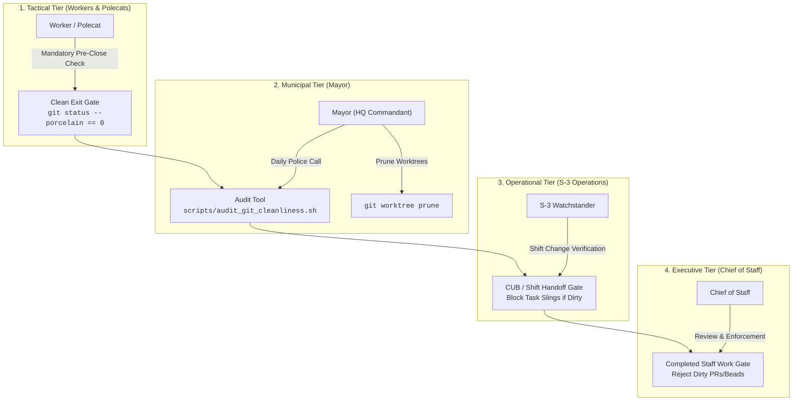
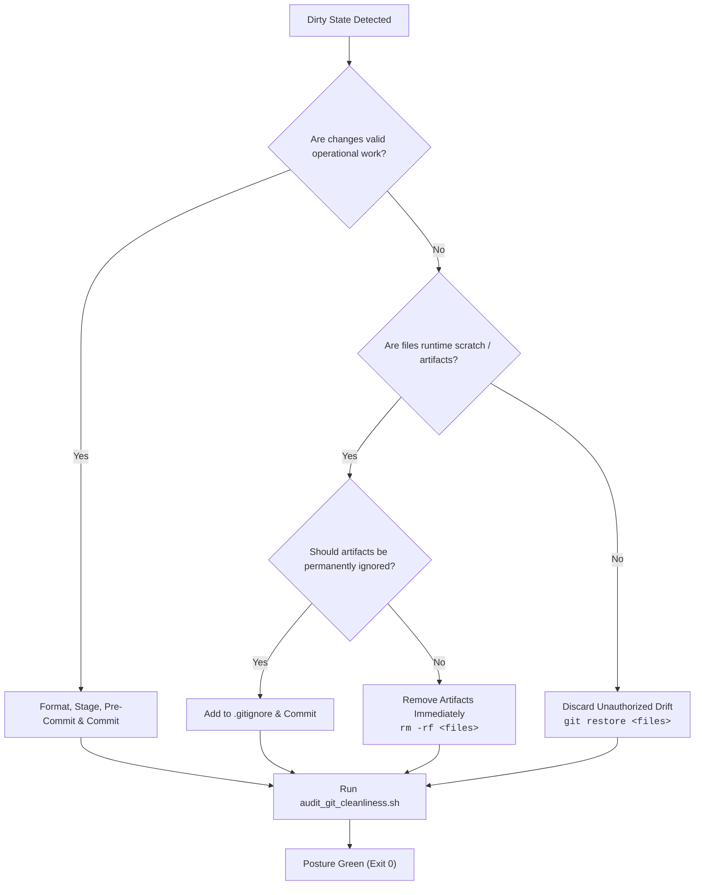

# Standard Operating Procedure: Git Worktree & Working Tree Cleanliness

```text
Document ID:     SOP-0.3-WORKTREE-CLEANLINESS
Document Type:   Standard Operating Procedure
Effective Date:  September 26, 2026
Lead Billets:    Mayor (Headquarters Commandant) & S-3 Operations
Reviewing Auth:  Chief of Staff (`colt-cos`), Camp Colt
Doctrine Ref:    USMC Staff Organization (MCRP 3-10A.1) & Completed Staff Work (MCTP 3-30A)
Parent Ref:      AGENTS.md, CPG Invariant #3, SOP-0.2-WATCH-POSTURE
Target Cluster:  Camp Colt Sovereign AI Command Post & Mounted Rigs
```

---

## 1. Purpose & Doctrinal Authority

Under Camp Colt doctrine (codified in `AGENTS.md` and `SOP_WATCH_POSTURE.md`), software repositories are classified as **Logistics Supply Depots (Class IX/VII digital material)**. A dirty git working tree or an orphaned secondary git worktree represents operational litter, unverified drift, and garrison decay.

In an autonomous multi-agent environment where workers, polecats, and toolchains generate continuous runtime artifacts (AST indices, scratch scripts, test outputs, SQLite states), unmanaged working trees inevitably lead to:

1. **Context Pollution**: Agents ingest stale scratch artifacts or untracked diffs, leading to hallucinated dependencies and incorrect code edits.
2. **Merge & Rebase Conflicts**: Uncommitted drift blocks clean git synchronization, halting automated CI/CD and Flux CD reconciliations.
3. **Supervisor Thrashing**: Command and Staff waste time diagnosing whether dirty trees represent in-flight operational work or abandoned debris.

This SOP establishes a rigorous, four-tier defense architecture ensuring that all working trees and secondary worktrees across `colony` and mounted rigs remain **100% clean and auditable at all times**.

---

## 2. Command Billet Responsibilities



| Billet                               | Role Title              | Cleanliness Responsibilities                                                                                                                         |
| :----------------------------------- | :---------------------- | :--------------------------------------------------------------------------------------------------------------------------------------------------- |
| **Tactical Workers (Polecats)**      | Ephemeral Agents        | Must enforce `git status --porcelain == 0` before closing any task bead. Must register EXIT traps to destroy temporary worktrees upon completion.    |
| **Mayor (`mayor`)**                  | Headquarters Commandant | Maintains camp hygiene. Conducts recurring "police calls" using `scripts/audit_git_cleanliness.sh`. Prunes dead worktrees and flags untracked drift. |
| **S-3 Operations (`s3-operations`)** | Tactical Lead           | Enforces clean-tree gates on all operational convoys. Rejects pull requests or task completions that fail clean-tree audits.                         |
| **Chief of Staff (`colt-cos`)**      | Operational Lead        | Verifies garrison cleanliness across shift boundaries. Ensures clean git posture is documented in every Commander's Update Brief (CUB).              |

---

## 3. Four-Tier Defense Architecture

### Tier 1: Tactical Worker Clean-Exit Gate

Every ephemeral worker or polecat dispatched via `gc sling` or running under a task bead must execute self-inspection before submitting completion reports:

1. **Working Tree Porcelain Audit**:

   ```bash
   git status --porcelain
   ```

   - **If modified files exist:** Commit verified changes with descriptive commit messages and pre-commit checks.
   - **If untracked runtime artifacts exist:**
     - If intended to be ignored permanently (e.g. build logs, cache directories), append to `.gitignore`.
     - If ephemeral test artifacts or scratch data, delete them immediately.

2. **Worktree Decommissioning**:
   If the worker created a secondary worktree for isolated compilation or testing, it must remove the worktree directory and execute:

   ```bash
   git worktree prune
   ```

3. **Hard Stop Condition**: No task bead may be transitioned to `CLOSED` (`status=closed`) if `git status --porcelain` returns any output.

### Tier 2: Scripted Worktree Lifecycle & Trap Discipline

Any automation or test harness script that dynamically allocates secondary git worktrees must enforce deterministic cleanup using POSIX shell trap handlers:

```bash
# Standard Worktree Creation & Cleanup Pattern
WORKTREE_DIR="$(mktemp -d -t colt-worktree-XXXXXX)"
git worktree add -b "temp-branch-${BEAD_ID}" "${WORKTREE_DIR}" "main"

# Deterministic cleanup on script exit, error, or termination
cleanup_worktree() {
    echo "Cleaning up worktree: ${WORKTREE_DIR}"
    git worktree remove --force "${WORKTREE_DIR}" 2>/dev/null || true
    git worktree prune 2>/dev/null || true
    git branch -D "temp-branch-${BEAD_ID}" 2>/dev/null || true
    rm -rf "${WORKTREE_DIR}" 2>/dev/null || true
}
trap cleanup_worktree EXIT INT TERM
```

### Tier 3: Turnkey Municipal Audit Tool (`audit_git_cleanliness.sh`)

The Mayor and staff execute `scripts/audit_git_cleanliness.sh` as the authoritative, zero-dependency audit mechanism across the entire estate:

```bash
# Standard municipal audit (exits 0 if clean, 1 if dirty)
./scripts/audit_git_cleanliness.sh

# Verbose inspection showing individual modified/untracked files
./scripts/audit_git_cleanliness.sh -v

# Audit with automatic worktree pruning
./scripts/audit_git_cleanliness.sh -p
```

The script audits:

1. **The Colony Root (`camp-colt`)**
2. **All mounted rigs in `rigs/*`** containing `.git` directories or worktree pointers (`a-staff`, `colt-results`, `colt-utils`, `go_template_rule`, `suitcase-ai`).

### Tier 4: Watch Cadence & Shift Handoff Discipline

Git working tree cleanliness is an explicit, mandatory inspection item during operational transitions:

1. **Shift Handoffs (`gc mail`):** Every shift handoff message from the Chief of Staff or S-3 must report working tree status across all rigs.
2. **Commander's Update Brief (CUB):** Daily 06:00 CUB documents must certify:

   ```markdown
   - **Garrison Git Cleanliness:** 100% clean across colony root and all 5 rigs; zero uncommitted diffs; zero orphaned worktrees.
   ```

3. **Friday Operational AARs:** Lingering untracked files or abandoned worktrees discovered during weekly retrospectives are treated as tactical discipline failures and logged in `docs/AAR_LOG.md`.

---

## 4. Remediation Runbook for Dirty Working Trees

When `scripts/audit_git_cleanliness.sh` reports a repository as `[DIRTY]`, the responsible staff officer or Mayor executes the following remediation protocol:



### Protocol Steps

1. **Inspect Drift**:

   ```bash
   git -C <rig-dir> status -s
   git -C <rig-dir> diff
   ```

2. **Classify Artifacts**:
   - **Valid Code/Doc Changes**: Run `pre-commit run --files <files>`, commit with authoritative bead reference, and push.
   - **Runtime Toolchain Debris (`.opencode/`, `*.sqlite`, `data/`, `runs/`)**: If reusable, append pattern to `.gitignore`. If transient test scrap, delete with `rm -rf`.
   - **Accidental Edits / Drift**: Discard immediately via `git restore <files>`.
3. **Prune Stale Worktrees**:

   ```bash
   git -C <rig-dir> worktree list
   git -C <rig-dir> worktree prune
   ```

4. **Re-Verify Cleanliness**:

   ```bash
   ./scripts/audit_git_cleanliness.sh
   ```

   Must return `RESULT: PASSED — 100% clean garrison git posture.`
