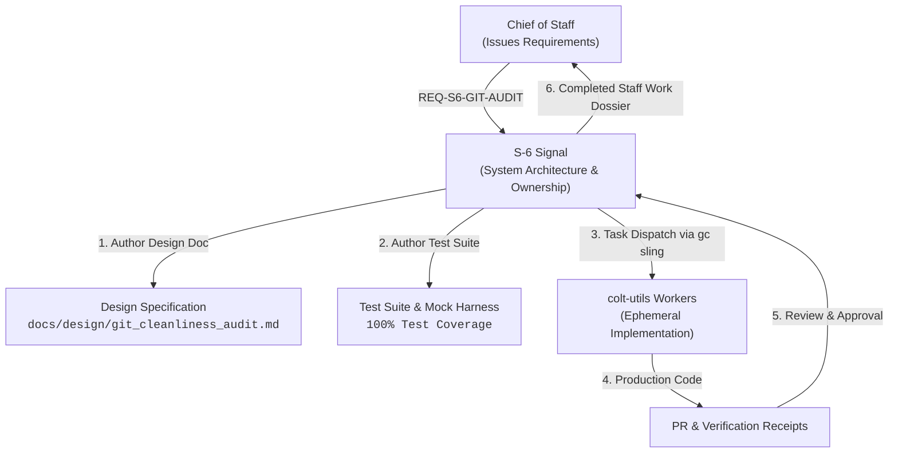

# Staff Requirements Document: Cross-Repository Git Cleanliness & Worktree Audit Tool

```text
Document ID:     REQ-S6-GIT-AUDIT-2026-09-26
Classification:  UNCLASSIFIED / STAFF DIRECTIVE
Tasking Billets: Chief of Staff (`colt-cos`) to S-6 Signal (`s6-signal`)
Implementation:  rigs/colt-utils (via Ephemeral Tactical Workers)
Doctrine Ref:    USMC Staff Organization (MCRP 3-10A.1) & Completed Staff Work (MCTP 3-30A)
Parent Ref:      AGENTS.md, SOP-0.3-WORKTREE-CLEANLINESS, CPG Invariant #1 & #3
```

---

## 1. Context & Operational Purpose

Under Camp Colt doctrine, software repositories are classified as **Logistics Supply Depots (Class IX/VII digital material)**. As multi-agent swarms operate across the colony, workers, polecats, and toolchains generate continuous runtime artifacts (AST indices, scratch scripts, test outputs, SQLite database state) and dynamically spawn secondary git worktrees for isolated task execution.

Per Command guidance, any operational tooling that spans **cross-repository boundaries** is formally assigned to the cognizance of **S-6 Signal (`s6-signal`)** as core communications and platform signal infrastructure.

This document issues formal engineering requirements to S-6 Signal to design, test, implement, and maintain a production-grade **Cross-Repository Git Cleanliness & Worktree Audit Tool** in [`rigs/colt-utils`](file:///home/camp-colt-mayor-agent/colony/rigs/colt-utils).

---

## 2. Billet Tasking & Lifecycle Mandate



S-6 Signal will not execute ad-hoc manual scripts, but will govern the full professional engineering lifecycle:

1. **Design Document**: Author an architectural and interface design specification in `rigs/colt-utils/docs/design/`.
2. **Test-Driven Specification**: Develop a rigorous test harness covering single-repo, multi-repo, clean, dirty, untracked, and detached worktree scenarios.
3. **Worker Delegation**: Dispatch ephemeral tactical workers (`colt-utils-worker`) to implement the tool within `rigs/colt-utils`.
4. **Completed Staff Work**: Deliver empirical test receipts and turnkey verification commands to Command upon completion.

---

## 3. Functional Requirements

### 3.1 Repository & Workspace Discovery

- **Discovery Scope**: The tool must dynamically discover the active colony root (`camp-colt`) and all mounted repository supply depots declared in `city.toml` or existing under `rigs/*`.
- **Link Awareness**: The tool must correctly distinguish between standard git clones (`.git/` directory), sub-worktrees (`.git` file referencing gitdir), and non-git directories.
- **Resilience**: Must gracefully handle uninitialized repos, permission boundaries, or detached HEAD states without crashing.

### 3.2 Working Tree Inspection

- **Porcelain Standardization**: Inspect git working tree status across all repositories using deterministic plumbing commands (`git status --porcelain=v1` or `v2`).
- **Classification**: Categorize detected drift into:
  - Modified tracked files (`M`)
  - Staged changes (`A`, `M`, `D`)
  - Untracked runtime artifacts (`??`)
  - Ignored artifacts (must remain suppressed per `.gitignore`)
- **Severity Grading**: Provide clear distinction between benign untracked scratch items vs. modified production code.

### 3.3 Git Worktree Lifecycle & Pruning

- **Worktree Inventory**: Query and report all registered secondary git worktrees per repository via `git worktree list --porcelain`.
- **Orphan Detection**: Identify dead worktrees where the worktree filesystem path no longer exists or where the backing branch has been merged/deleted.
- **Safe Pruning**: Provide an explicit operator flag (`--prune`) that invokes `git worktree prune` across all target repositories. Mutation actions must **never** run by default.

### 3.4 CLI Interface & Output Formats

- **Standard Human-Readable Output (Default)**:
  - Tabular display indicating: Repository Name, Status (`[OK]` vs. `[DIRTY]`), Modified Count, Untracked Count, Active Worktree Count.
  - Clear visual summary line (e.g. `6 repos checked | 0 dirty | 0 orphaned worktrees`).
- **Machine-Readable Output (`--json`)**:
  - Structured JSON schema suitable for programmatic ingestion by municipal watchstanders, Gas City hooks, and automated CI pipelines.
- **Verbose Mode (`-v` / `--verbose`)**:
  - Inlines the exact porcelain status lines and worktree paths for immediate developer triage.
- **Warning Mode (`--warn-only` / `-w`)**:
  - Emits status warnings but exits with returncode `0` (for non-blocking advisory checks).

### 3.5 Exit Code Contract

- `0`: **All Clean** — 100% of discovered repositories have clean working trees and zero orphaned worktrees.
- `1`: **Garrison Drift Detected** — One or more repositories contain uncommitted modifications, untracked files, or dead worktrees.
- `2`: **Execution / Configuration Error** — Invalid CLI flags, unreadable filesystem paths, or missing git dependencies.

---

## 4. Non-Functional & Performance Requirements

1. **Execution Latency**: The audit must execute and return within **$< 1.0\text{ second}$** across the entire Camp Colt estate (10+ repositories).
2. **Zero Plaintext Secrets**: Must never leak secret tokens or environment credentials into stdout/stderr or log files.
3. **Unprivileged Execution**: Must execute strictly under standard unprivileged POSIX identities without standing root or `sudo` requirements.
4. **Maintenance & Packaging**: Maintained as an authoritative tool in `rigs/colt-utils`. A symlink or turnkey entrypoint will be mounted into `scripts/` or `$PATH` for the Mayor and staff officers.

---

## 5. Verification & Acceptance Criteria

To achieve Completed Staff Work acceptance, S-6 Signal must deliver:

- [ ] Approved Design Document in `rigs/colt-utils/docs/design/`.
- [ ] Automated test suite with $\ge 90\%$ branch coverage including positive, dirty, and error test cases.
- [ ] Production tool implemented in `rigs/colt-utils` passing all local linter and pre-commit checks.
- [ ] Live verification receipt demonstrating execution against the Camp Colt estate with human-readable and `--json` outputs.
- [ ] Formal completion dispatch submitted to Chief of Staff via `gc mail` with bead reference.
