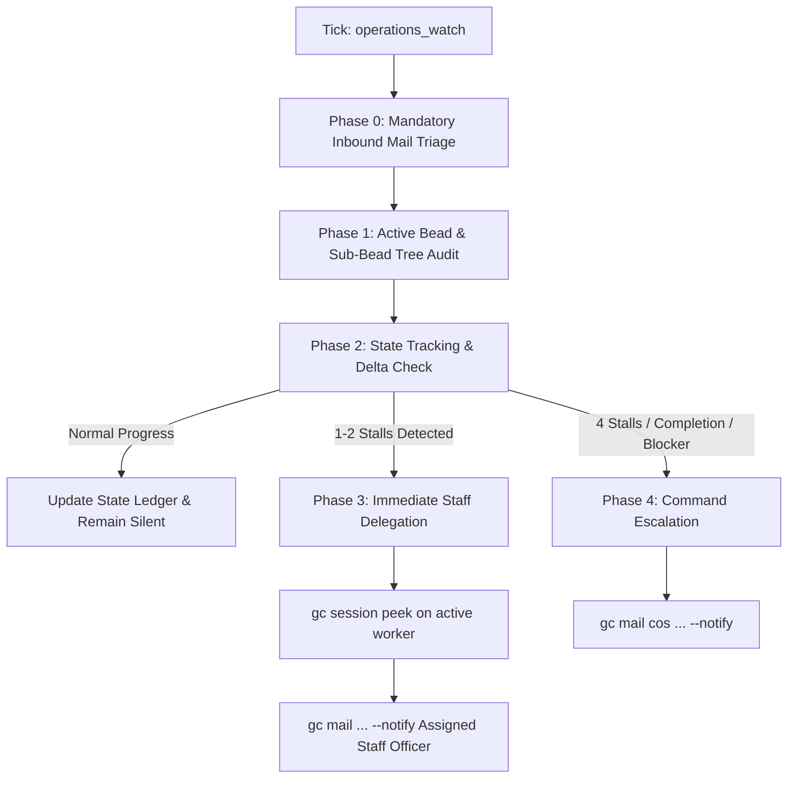

# Standard Operating Procedure: Operations Watch Patrol & Stagnation Detection Protocol

**Document ID**: `SOP-S3-OPS-WATCH-001`
**Document Type**: Standard Operating Procedure & Tactical Directive
**Custodian**: S-3 Operations (`s3-operations`), Camp Colt
**Administrative Review**: S-1 Personnel & Administration (`s1-personnel`), Camp Colt
**Approving Authority**: Chief of Staff (`colt-cos`), Camp Colt
**Standard**: Completed Staff Work (CPG Baseline)
**Target Environment**: Camp Colt Sovereign AI Command Post & Mounted Rigs
**Target Audience**: All Staff Billets (`cos`, `mayor`, `s1-personnel`, `s3-operations`, `s4-logistics`, `s6-signal`, `colt-sysadmin`)
**Effective Date**: 2026-10-08
**Status**: APPROVED (Completed Staff Work)

---

## 1. Purpose & Doctrinal Intent

In accordance with the Commander's Planning Guidance (CPG) and MCTP 3-30A (_Command and Staff Action_), Camp Colt enforces continuous, empirical oversight of all active operational tasks. Autonomous multi-agent swarms and tactical workers frequently encounter silent stalls, compilation loops, parsing timeouts, or unmonitored crash loops.

This SOP codifies the **Operations Watch Patrol Protocol** and establishes the generic Gas City scheduled order [`orders/operations_watch.toml`](../../orders/operations_watch.toml) to systematically inspect active beads, maintain structured state tracking across watch intervals, detect worker stagnation, delegate intervention to assigned staff officers, and escalate unresolvable friction to Command.

_(Note: Inter-staff communications watch and priority delivery are strictly the cognizance of S-6 Signal governed under [`SOP_SIGNAL_COMMUNICATIONS_WATCH_AND_PRIORITY_DELIVERY.md`](SOP_SIGNAL_COMMUNICATIONS_WATCH_AND_PRIORITY_DELIVERY.md).)_

---

## 2. Watch Cadence & Scheduling Parameterization

The watch patrol executes via a configurable Gas City order (`orders/operations_watch.toml`). Its execution interval is fully parameterizable to match the active operational posture:

| Operational Posture                    | Watch Cadence    | Schedule Expression         | Typical Context                                                      |
| :------------------------------------- | :--------------- | :-------------------------- | :------------------------------------------------------------------- |
| **Tactical Sprint / Active Benchmark** | **15 Minutes**   | `schedule = "*/15 * * * *"` | Live model cutovers, active hardware benchmarking, critical PR gates |
| **Normal Operational Day**             | **1 Hour**       | `schedule = "0 * * * *"`    | Standard daytime staff coordination, routine bead execution          |
| **Sustained Campaign Watch**           | **2 to 4 Hours** | `schedule = "0 */2 * * *"`  | Extended multi-rig convoy drains, overnight long-running builds      |
| **Quiescent Command Post Standby**     | **8 Hours**      | `schedule = "0 */8 * * *"`  | Operational pauses, hardware maintenance windows, weekend watch      |

_Note: Changes to the active cadence interval are municipal lifecycle operations executed by the Mayor upon tasking from the Chief of Staff or S-3 Operations._

---

## 3. The 5-Step Watch Protocol

At each scheduled tick of the operations watch, the watchstander (or automated patrol script [`commands/operations_watch.sh`](../../commands/operations_watch.sh)) executes five sequential inspection phases:



### Phase 0: Mandatory Inbound Mail Triage

> [!IMPORTANT] > **Every watch cycle MUST begin with reading and processing all unread mail.**
>
> The watchstander executes:
>
> ```bash
> gc mail inbox --json
> gc mail read <message-id>
> ```
>
> All directives, technical receipts, staff updates, and blocker escalations received since the prior watch cycle are triaged and logged before evaluating task progress.

### Phase 1: Active Bead & Sub-Bead Tree Audit

1. Query all active beads assigned to the watchstander's billet or active convoys across rigs:

   ```bash
   gc bd list --json
   gc bd --rig suitcase-ai list --json
   gc bd --rig gascity list --json
   ```

2. For each parent bead, resolve its constituent sub-bead tree, child tasks, and assigned worker sessions:

   ```bash
   gc session list --json
   ```

3. Identify all sub-beads currently in `in_progress` or unassigned `open` state within active convoys.

### Phase 2: State Tracking Ledger & Delta Check

To guarantee accurate detection of "same state" stalls across intervals, the watch maintains a structured tracking ledger at `.gc/runtime/watch/operations_watch_state.json` (or summary Markdown `.gc/runtime/watch/operations_watch_state.md`).

1. **State Ledger Schema**:
   For each tracked parent bead and sub-bead, record:

   - `bead_id`: Identifier (e.g. `gcs-6fu`, `sa-8h6`).
   - `title`: Short descriptive title.
   - `assignee`: Staff billet or worker session.
   - `status`: `open`, `in_progress`, `blocked`, `closed`.
   - `worktree_head`: Git commit hash / dirty state (`git rev-parse HEAD`, `git status -s`).
   - `worker_session_id`: Active session ID from `gc session list`.
   - `last_nudge_age`: Age of last nudge/activity.
   - `last_log_hash`: Checksum or line count of recent task execution log.
   - `stagnation_count`: Consecutive watch cycles with zero state change.
   - `last_updated`: Timestamp of last observed progress.

2. **State Delta Evaluation**:
   Compare the current audit against the previous ledger entry:
   - **Progress Observed**: If `worktree_head`, test results, or task logs changed, reset `stagnation_count = 0` and update `last_updated`.
   - **Same State (Stall)**: If the bead remains `in_progress` with identical worktree commit, zero file changes, and unchanged worker activity, increment `stagnation_count += 1`.

---

## 4. Immediate Delegation & Graduated Escalation Matrix

### 4.1 Chief of Staff Notification Doctrine (Zero-Noise Policy)

> [!IMPORTANT] > **The Chief of Staff (`colt-cos`) shall NOT be notified on "normal progress" during routine watch cycles.**
>
> The Operations Watch communicates with `colt-cos` **ONLY** on the following explicit trigger conditions:
>
> 1. **Milestone / Bead Completion**: When a major bead, convoy, or deliverable is verified closed with receipts.
> 2. **Noted Escalation (4-Session Stall)**: When a workstream remains stagnant across 4 consecutive watch checks despite staff intervention.
> 3. **Clarifications Needed**: When an operational directive contains ambiguities or conflicting constraints requiring Command interpretation.
> 4. **User / Human Intervention Required**: When physical hardware action (e.g. cable pull, DIMM swap), credential rotation, or external authority is blocked.

### 4.2 Graduated Escalation Ladder

| Stagnation State       | Action Level                       | Notification Recipient                          | Mechanism                  | Required Action                                                                               |
| :--------------------- | :--------------------------------- | :---------------------------------------------- | :------------------------- | :-------------------------------------------------------------------------------------------- |
| **Normal Progress**    | Level 0                            | None (Silent)                                   | Ledger update              | Record state delta silently; zero mail sent to CoS.                                           |
| **1–2 Session Stalls** | Level 1: Immediate Delegation      | **Assigned Staff Officer** (e.g. S-6, SRE, S-4) | `gc mail ... --notify`     | Watchstander immediately delegates to assigned staff officer with session peek diagnostics.   |
| **3 Session Stalls**   | Level 2: Direct Nudge & Repetition | Assigned Staff Officer                          | `gc session nudge` + mail  | Staff officer nudges worker or re-cycles worker session.                                      |
| **4 Session Stalls**   | Level 3: Command Escalation        | **Chief of Staff (`colt-cos`)**                 | `gc mail cos ... --notify` | Formal escalation to Command for worker recycling, task reassignment, or scope re-baselining. |
| **Bead Completion**    | Level 0 (Milestone)                | Chief of Staff (`colt-cos`)                     | `gc mail cos`              | Transmit Completed Staff Work receipts and test verification.                                 |

### 4.3 Action Protocol for the Assigned Staff Officer (Level 1 Intervention)

When an assigned staff officer receives a Level 1 stagnation alert (`gc mail ... --notify`), the officer must immediately execute the following diagnostic checklist:

1. **Terminal Inspection (`gc session peek`)**:

   ```bash
   gc session peek <session-id> --lines 40
   ```

   Determine if the worker is:

   - Trapped in infinite deliberation or token generation loops.
   - Crashing on unhandled tool errors or syntax exceptions.
   - Stalled waiting for external input or locked resources.

2. **Worktree & Lock Audit**:

   ```bash
   git -C <worktree-path> status -s
   ls -la <worktree-path>/.git/*.lock 2>/dev/null || true
   ```

   Verify whether stale lockfiles or uncommitted dirty changes are blocking execution.

3. **Active Remediation (Nudge, Prompt Repair, or Re-sling)**:

   - If stalled on prompt interpretation: send a clarifying prompt via `gc session nudge <session-id> "<guidance>"`.
   - If wedged in an unrecoverable process state: terminate the crashed session and re-sling a fresh worker via `gc sling <agent> <bead-id> --on <formula>`.

4. **Status Feedback**:
   - Reply to the watchstander confirming actions taken and estimated time to completion.

---

## 5. Generic Gas City Order Definition

The order is maintained at [`orders/operations_watch.toml`](../../orders/operations_watch.toml):

```toml
# orders/operations_watch.toml
# Generic Operations Watch Order for Camp Colt
# Cadence adjustable: "*/15 * * * *" (15m), "0 * * * *" (1h), "0 */8 * * *" (8h)

[order]
description = "Generic Operations Watch: Inbound mail triage, active sub-bead ledger tracking, stagnation delegation, and CoS escalation"
exec = "commands/operations_watch.sh"
trigger = "cron"
schedule = "*/15 * * * *"
```

---

## 6. Staff Billets & Responsibilities

- **S-3 Operations (`s3-operations`)**: Doctrinal proponent and operational custodian of the watch patrol. Manages state ledger, analyzes deltas, delegates to staff, and escalates 4-session stalls.
- **S-6 Signal (`s6-signal`)**: Communications watchstander. Custodian of inter-staff communications watch and automated message priority delivery per [`SOP_SIGNAL_COMMUNICATIONS_WATCH_AND_PRIORITY_DELIVERY.md`](SOP_SIGNAL_COMMUNICATIONS_WATCH_AND_PRIORITY_DELIVERY.md).
- **S-1 Personnel & Administration (`s1-personnel`)**: Doctrinal records custodian of `rigs/a-staff`. Formats and maintains administrative compliance of this SOP.
- **Mayor (`mayor`)**: Municipal controller. Owns the physical configuration of `orders/operations_watch.toml`, manages order registration, and adjusts schedule intervals via `gc reload`.
- **Chief of Staff (`colt-cos`)**: Approving authority for watch interval adjustments, recipient of completions, 4-session escalations, and clarifications.
