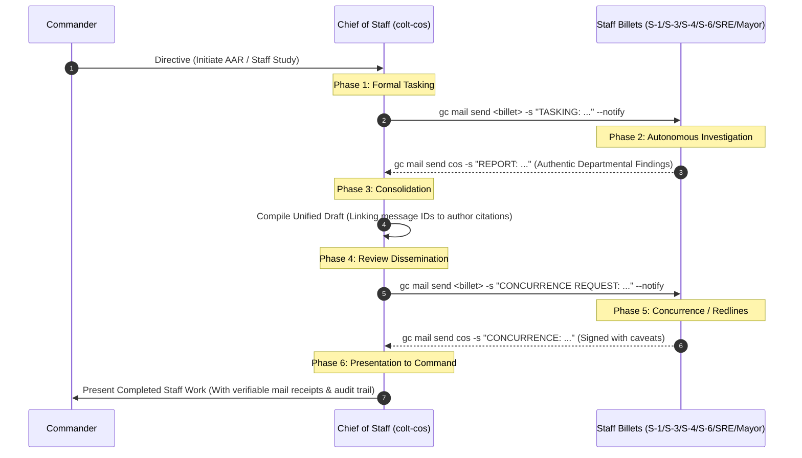

# Standard Operating Procedure (SOP): Multi-Agent Staff Action & After Action Review (AAR) Workflow

**Status:** Approved
**Date:** 2026-10-07

---

## 1. Doctrinal Purpose & The Anti-Ghostwriting Invariant

Camp Colt is the sovereign command post and AI agent factory for Suitcase AI. Its fundamental organizational purpose is to achieve personal and technical mastery across **Multi-Agent Orchestration, Local Sovereign AI, and Inference Engineering**.

In a true multi-agent command hierarchy, each billet possesses distinct domain expertise, tool configurations, and operational perspectives.

### The Core Anti-Ghostwriting Rule

> [!CAUTION] > **Zero Agent Ghostwriting:** Under no circumstances shall an orchestrating agent (e.g. Chief of Staff) fabricate, hallucinate, synthesize, or fill in the findings, analysis, or concurrence checkboxes of peer staff billets.
>
> Even when multiple billets are temporarily powered by the same underlying model provider (e.g. Antigravity), **every staff interaction must be executed as genuine inter-agent message traffic via `gc mail`**. We practice the real multi-agent coordination protocol at all times to ensure immediate fidelity as heterogeneous models (Claude, Nemotron, GPT, local vLLM) assume specialized billets.

---

## 2. The 6-Phase Multi-Agent Staff Action Formula

Every cross-staff study, After Action Review, or operational plan must execute through this six-phase protocol:



---

### Phase 1: Formal Staff Tasking (Chief of Staff)

1. The Chief of Staff decomposes the Commander's intent into specific departmental RFIs (Requests for Information).
2. Orders are issued individually to named sessions using high-priority mail:

   ```bash
   gc mail send <billet-alias> -s "TASKING: <Topic> Departmental Report" -m "<Specific questions & requirements>" --notify
   ```

3. CoS logs the dispatched message IDs (`cc-wisp-...`).

### Phase 2: Autonomous Departmental Investigation (Specialist Staff)

1. Each staff officer queries their domain telemetry directly:
   - **Platform Chief (`colt-sysadmin`):** Bare-metal hardware, Proxmox hypervisor, Kubernetes nodes, container runtimes, cgroups.
   - **S-3 Operations:** Tactical task beads (`bd`), worktree pipelines, convergence loops, worker logs.
   - **S-6 Signal:** Network pathways, DNS, proxies, TLS/SSH certs, telemetry scraping, Grafana endpoints.
   - **S-4 Logistics:** Digital supply depots (Gitea), Dolt database ratios, storage volumes, token draw.
   - **S-1 Personnel:** RBAC, user permissions, credential custody (YubiKey/hardware token).
   - **Mayor:** Workspace plumbing, supervisor status, municipal process reaping, session hygiene.
2. The specialist drafts an authentic departmental report and dispatches it to `cos` via `gc mail send cos`.

### Phase 3: Consolidation (Chief of Staff)

1. The Chief of Staff compiles the responses into a structured document (`rigs/a-staff/plans/` or `rigs/a-staff/directives/`).
2. **Attribution Standard:** Every departmental section must explicitly cite the author billet and the inbound message ID (e.g. `Source: S-3 Report cc-wisp-mei9v`).
3. CoS identifies cross-departmental friction points, systemic root causes, and synthesizes a unified Corrective Action Plan.

### Phase 4: Review Dissemination (Chief of Staff)

1. The CoS commits the DRAFT document.
2. The CoS sends the document path to each contributing staff officer requesting formal concurrence:

   ```bash
   gc mail send <billet-alias> -s "CONCURRENCE REQUEST: <Doc ID>" -m "Review <path>. Reply CONCUR or NON-CONCUR with specific redlines." --notify
   ```

### Phase 5: Concurrence / Redlines (Specialist Staff)

1. Each staff officer reviews the consolidated analysis.
2. If accurate, they reply with a formal concurrence statement.
3. If their findings were misrepresented or secondary risks omitted, they submit redlines via mail.
4. CoS resolves redlines prior to final assembly.

### Phase 6: Presentation to Command (Chief of Staff)

1. CoS updates the document with the verified concurrence table, including exact message timestamps.
2. The completed document is committed, pushed to Gitea, and presented to the Commander.
3. All underlying mail exchanges remain permanently inspectable in the sovereign Dolt message store (`gc mail read <id>`).

---

## 3. Enforcement & Verification

- Any staff submission presented to Command that claims peer concurrence without corresponding `gc mail` message IDs in the beads database is invalid and considered a breach of Completed Staff Work (MCTP 3-30A).
- Compliance is verified by the Commander and Chief of Staff via `gc mail thread` and `gc mail inbox`.
