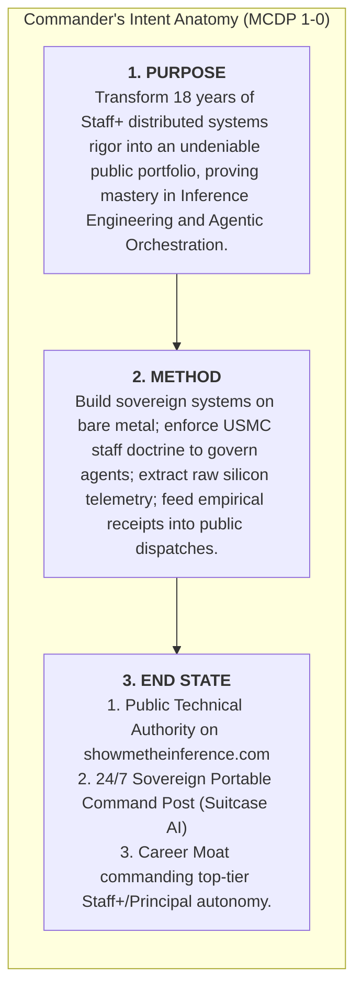
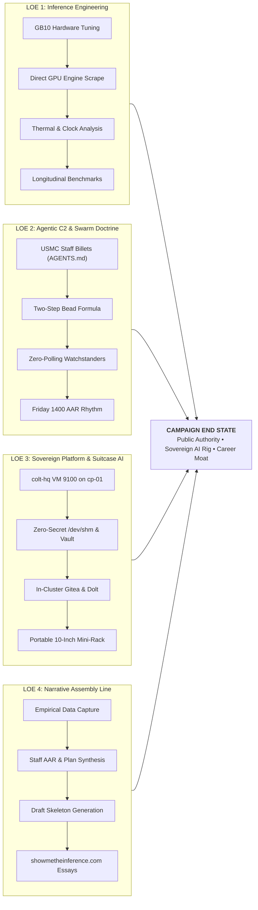
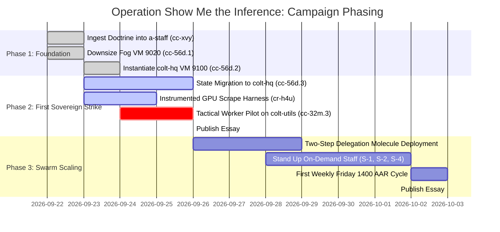

# Campaign Plan: Operation "Show Me the Inference"

```
Document ID:     OPLAN-COLT-2026-SHOW-THE-INFERENCE
Classification:  UNCLASSIFIED / STRATEGIC PORTFOLIO BLUEPRINT
Commander:       Nick Chalko
Facilitator:     Chief of Staff (`colt-cos`), Camp Colt
Doctrinal Ref:   MCDP 1 (Warfighting), MCDP 1-0 (Operations), MCTP 3-30A (Command & Staff Action)
Master Brand:    Show Me the Inference (`https://showmetheinference.com`)
Target Cluster:  Camp Colt Sovereign AI Command Post & Suitcase AI Mini-Rack
```

---

## Executive Summary & Strategic Context

After 18 years building distributed systems and infrastructure at Google, corporate NDAs and proprietary internal tooling (Borg, Piper, Spanner) leave zero public footprint. Today’s software landscape has permanently shifted: **syntax generation is no longer the engineering bottleneck, and toy prompt-wrappers do not demonstrate technical authority.**

The combined mission of **Suitcase AI** and **Camp Colt (`a-staff`)** is to serve as the **living, public engineering portfolio for Nick Chalko**. It demonstrates mastery across three indispensable pillars of modern high-value computing:
1. **Inference Engineering & Hardware Sympathy:** Operating cutting-edge silicon (ASUS Ascent GX10 / NVIDIA Grace Blackwell GB10), tuning unified memory architectures (UMA), and extracting sub-millisecond kernel telemetry.
2. **Deterministic Agentic Orchestration:** Eliminating LLM supervisor thrashing and hallucinated task closure by adapting rigorous military command-and-control doctrine (USMC MCTP 3-30A) to autonomous agent swarms.
3. **Sovereign, Cloud-Free Systems Architecture:** Operating an air-gapped, portable 24/7 AI command post (Suitcase AI) with immutable cloud-init baselines, zero plaintext secrets, and local versioned ledgers (Dolt).

Every operational milestone in Camp Colt produces empirical receipts (telemetry timeseries, benchmarks, code, and architectural dossiers) that feed directly into deep-dive public essays on **`https://showmetheinference.com`**.

---

## I. Commander's Intent



### 1. Purpose (The "Why")
To decisively demonstrate Staff/Principal-level competence in modern AI systems engineering. The campaign generates public, verifiable proof that Nick Chalko can architect, deploy, tune, and orchestrate production-grade local foundation models and autonomous multi-agent battalions without reliance on commercial cloud APIs.

### 2. Method (The "How")
We reject trivial "hello world" LLM wrappers in favor of hard-nosed systems engineering:
* **Hardware-Mechanical Sympathy:** Treat inference as an applied hardware engineering discipline—measuring physical LPDDR5X UMA memory bus contention, Grace Blackwell SM clock frequencies, thermal throttling, and prefill vs. decode latency directly from the GPU host.
* **Doctrinal Command & Control:** Treat agent swarms as distributed state machines governed by Marine Corps staff doctrine (MCTP 3-30A). Enforce the **Two-Step Bead Formula** (Implementer $\rightarrow$ S-3 Review Gate) to eliminate supervisor polling and context degradation.
* **The Mission-to-Post Pipeline:** Every tactical victory produces empirical data (Grafana snapshots, Prometheus timeseries, flamegraphs) that is packaged by the staff into publication-ready technical essays.

### 3. Strategic End State
1. **Public Technical Authority:** `showmetheinference.com` is established as an essential reference for systems engineers, AI architects, and engineering leaders seeking ground truth on local inference and multi-agent coordination.
2. **The Sovereign Command Post (Suitcase AI):** A 10" mini-rack housing a self-sufficient, 24/7 agent factory operating with zero cloud token invoices, zero plaintext secrets, and native NVMe storage.
3. **Career Independence & Market Moat:** A public portfolio so dense with empirical evidence that it guarantees immediate technical credibility and executive autonomy in any future role.

---

## II. Center of Gravity (COG) Analysis

In Marine Corps campaign design, identifying the Center of Gravity (the primary source of moral or physical strength) ensures all tactical efforts reinforce the strategic goal:

* **Strategic Center of Gravity:** **Empirical Reproducibility ("The Receipts").**
  * *Rationale:* Anyone on social media can claim to build AI agents or run local LLMs. Your competitive moat is providing the exact YAML manifests, raw Prometheus timeseries curves, terminal curl benchmarks, and architectural post-mortems that prove execution on real hardware.
* **Critical Capabilities Required:**
  1. *Silicon Observability:* Direct extraction of GPU host telemetry (DCGM, vLLM engine, PVE) bypassing edge gateway abstraction.
  2. *Swarm Stability:* Autonomous agent coordination that runs continuously without supervisor thrashing, memory leaks, or context corruption.
  3. *Editorial Rhythm:* Rapid translation of internal staff AARs and benchmark dossiers into polished, reader-friendly blog essays.

---

## III. Campaign Lines of Effort (LOEs)



---

### Line of Effort 1: Inference Engineering on Bare Metal
* **Strategic Objective:** Master and document the physical realities of running 49B–70B foundation models on modern unified-memory architectures.
* **Key Technical Battles:**
  * **Unified Memory (UMA) Clamping:** Managing the 128 GiB LPDDR5X bus on the GB10; proving why `NIM_GPU_MEMORY_UTILIZATION` must clamp to `0.75` (96 GiB) to reserve a mandatory 32 GiB buffer for the Linux kernel and I/O.
  * **Dual-Tap Telemetry:** Pairing direct engine metrics from `colt-gpu-01:8000` (prefill latency, decode time, VRAM KV cache, Radix prefix hits) with LiteLLM proxy timings to calculate the exact Gateway Overhead Tax.
  * **Thermal & Throttling Limits:** Correlating Streaming Multiprocessor clocks (`DCGM_FI_DEV_SM_CLOCK`) with GPU core temps (`DCGM_FI_DEV_GPU_TEMP`) to detect thermal clock step-downs under sustained multi-agent workloads.
* **Decisive Artifacts:**
  * [`battlebook/models/sparkleader-nemotron-49b.md`](file:///home/camp-colt-mayor-agent/colony/rigs/a-staff/battlebook/models/sparkleader-nemotron-49b.md)
  * `rigs/colt-results/benchmarks/` versioned datasets (`BENCH-v1.0-nemotron49b-baseline`).

---

### Line of Effort 2: Agentic C2 & Swarm Doctrine
* **Strategic Objective:** Solve the core failure mode of autonomous agent swarms—supervisor thrashing and unverified task completion—by implementing military staff doctrine.
* **Key Technical Battles:**
  * **Watch Posture Tiers:** Formalizing the Always-On Core (`cos`, `mayor`, `s3`, `s6`), On-Demand Specialists (`s1`, `s2`, `s4`, `colt-sysadmin`), and Ephemeral Polecats.
  * **The Two-Step Delegation Molecule:** Eliminating manual session peeking; replacing polling with automated review hand-offs (Step 1 Implementer $\rightarrow$ Step 2 S-3 Verification Gate).
  * **Completed Staff Work Standard (MCTP 3-30A):** Forbidding "the YAML looks good" closures; mandating empirical causal proofs and single-step reproduction links.
  * **Battle Rhythm Synchronization:** Daily 0600 CUB automated at 05:15 PDT; weekly Friday 1400 AAR for watchdog and timeout tuning.
* **Decisive Artifacts:**
  * [`docs/SOP_WATCH_POSTURE.md`](file:///home/camp-colt-mayor-agent/colony/docs/SOP_WATCH_POSTURE.md)
  * [`rigs/a-staff/references/`](file:///home/camp-colt-mayor-agent/colony/rigs/a-staff/references/) (`MCRP 3-10A.1`, `MCTP 3-30A`)
  * [`rigs/a-staff/plans/SOP_WEEKLY_TASK_FRICTION_AAR.md`](file:///home/camp-colt-mayor-agent/colony/rigs/a-staff/plans/SOP_WEEKLY_TASK_FRICTION_AAR.md)

---

### Line of Effort 3: Sovereign Platform & Suitcase AI
* **Strategic Objective:** Build and demonstrate an immutable, portable, air-gapped software factory operating inside a 10" mini-rack with zero external dependencies.
* **Key Technical Battles:**
  * **Hypervisor Command Post Migration (`cc-56d`):** Porting Camp Colt from developer laptop Multipass to a dedicated hypervisor VM (`colt-hq` VM 9100 on `colt-cp-01` @ `10.82.0.20`), eliminating host laptop fragility.
  * **Clean Single-User Baseline:** Cloud-init automation provisioning `camp-colt-mayor-agent` (UID 1000) with passwordless sudo, eliminating legacy dual-user nesting (`ubuntu` vs `camp-colt-mayor-agent`).
  * **Zero Plaintext Secrets:** Vault mTLS token injection, memory-backed `/dev/shm` credentials, and unprivileged POSIX identities across all agent roles.
  * **In-Cluster Persistence:** Local Dolt versioned SQL ledgers and internal Gitea forge (`gitea.colt.chalko.com`) operating offline.
* **Decisive Artifacts:**
  * `provision/colt_hq.tf` & `provision/fog/variables.tf` (commit `c59194e`)
  * `rigs/suitcase-ai/` infrastructure manifests.

---

### Line of Effort 4: The Narrative Assembly Line (`showmetheinference.com`)
* **Strategic Objective:** Seamlessly convert internal engineering victories into published essays, technical threads, and community field reports.
* **The Four-Stage Publishing Assembly Line:**
  1. **Telemetry Harvest (Tactical Level):** Workers execute beads and output raw Prometheus timeseries, benchmark JSONs, and Grafana panel snapshots into `rigs/colt-results/`.
  2. **Technical AAR Compilation (Operational Level):** S-3 and Platform Chief compile the technical dossier in `rigs/a-staff/plans/` explaining the failure modes, design choices, and metrics.
  3. **Editorial Article Skeleton (Staff Level):** Chief of Staff synthesizes the dossier into a structured, narrative blog post outline following the *Show Me the Inference* voice.
  4. **Commander Publication (Executive Level):** Commander reviews, infuses his 18-year Google perspective and personal voice, and publishes to `https://showmetheinference.com`.

---

## IV. Campaign Phasing & Decisive Milestones



### Phase 1: Foundation & Infrastructure Hardening (COMPLETED)
* Stood up `a-staff` with complete USMC doctrine (`MCRP 3-10A.1`, `MCTP 3-30A`).
* Downsized Fog VM 9020, freeing 3.58 GB RAM on `colt-cp-01`.
* Instantiated `colt-hq` (VM 9100) with clean UID 1000 baseline at `10.82.0.20`.
* Codified Always-On Core and automated 0600 CUB battle rhythm.

### Phase 2: First Sovereign Strike (IN PROGRESS — MAIN EFFORT)
* **Milestone 2.1:** Execute instrumented benchmark re-run (`cr-h4u`) capturing direct GPU host metrics (prefill vs decode, physical VRAM KV cache, SM clock throttling) bracketed across the $T_{-60\text{s}}$ to $T_{+60\text{s}}$ window.
* **Milestone 2.2:** Execute first autonomous tactical worker pilot (`cc-32m.3`) on `rigs/colt-utils` (`cu-60m`) routed to local Nemotron-49B.
* **Milestone 2.3:** Execute parallel state migration (`cc-56d.3`) to `colt-hq`, severing the laptop Multipass umbilical cord.
* **Publication Target 1:** *"Taming Grace Blackwell: Unified Memory Clamping, GPU Telemetry, and Why We Bypass Edge Gateways for Raw Truth."*

### Phase 3: Swarm Scaling & Doctrinal Governance
* **Milestone 3.1:** Stand up on-demand staff billets (`s1-personnel`, `s2-intel`, `s4-logistics`) with scoped Gitea API tokens.
* **Milestone 3.2:** Deploy the Two-Step Bead Formula across all rigs, proving zero supervisor peeking.
* **Milestone 3.3:** Execute the first formal Friday 1400 Task Friction AAR.
* **Publication Target 2:** *"Why Your AI Agent Swarm Needs Marine Corps Doctrine: Enforcing Completed Staff Work and Eliminating LLM Polling."*

### Phase 4: Full Portability & The Sovereign Moat
* **Milestone 4.1:** Package Suitcase AI as a fully reproducible, self-contained 10" mini-rack deployment.
* **Milestone 4.2:** Publish open-source replication blueprints and unit economics analysis (fixed hardware vs. $5,000/mo token burn).
* **Publication Target 3:** *"Building the 24/7 Sovereign Agent Factory: Cutting the Cord to the Cloud."*

---

## V. Staff Section Cognizance for the Campaign

To ensure every staff officer supports the campaign without boundary friction:

| Staff Section | Campaign Cognizance & Deliverable Responsibilities |
| :--- | :--- |
| **Chief of Staff (`colt-cos`)** | Orchestrates campaign lines of effort, enforces Completed Staff Work, liaises with Commander, translates internal AARs into publication skeletons. |
| **Mayor (`mayor`)** | Maintains the Gas City town root, session scaffolding, `city.toml` mounting, and physical workspace hygiene; zero operational planning. |
| **S-3 Operations (`s3-operations`)** | Manages the virtual Combat Operations Center (COC), decomposes operational epics into task beads, dispatches workers, enforces clean-tree gates. |
| **S-6 Signal & Cyber (`s6-signal`)** | Oversees gateway routing, proxy sanitization, communications pipelines, TLS/PKI transit, and zero-secret commit audits. |
| **Platform SRE (`colt-sysadmin`)** | Manages physical hypervisors, K8s cluster, Proxmox VE, storage pools, hardware telemetry (DCGM), and immutable cloud-init templates. |
| **S-4 Logistics (`s4-logistics`)** | Manages Gitea repository depots, storage quotas, token accounting, and ReadyLocker NVMe model weights. |
| **S-1 Personnel (`s-1`)** | Manages Non-Human Identity (NHI) mappings, RBAC permissions, and future integration of the Press Rig (`rigs/press`). |
| **S-2 Intelligence (`s-2`)** | Executes codebase AST terrain indexing, technical runbook synthesis, and dependency vulnerability research. |

---

## VI. Open Strategic Questions for Commander's Inline Review

1. **Publication Frequency:** Does a bi-weekly deep dive on `showmetheinference.com` match your target bandwidth, supported by shorter technical dispatches to the Gas Town Discord and X/Twitter?
2. **First Essay Target:** Shall we target Milestone 2.1 / 2.2 (the Grace Blackwell direct telemetry & `colt-utils` local worker pilot) as the official maiden technical post?
3. **Press Rig Timing:** S-1 will eventually oversee the Press Rig (`rigs/press`). Should we migrate `press` from London Fog once `colt-hq` state migration completes, or keep it on London Fog until Phase 3?
