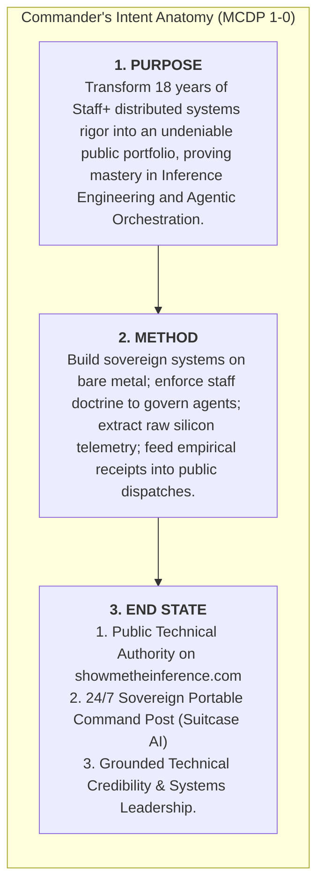
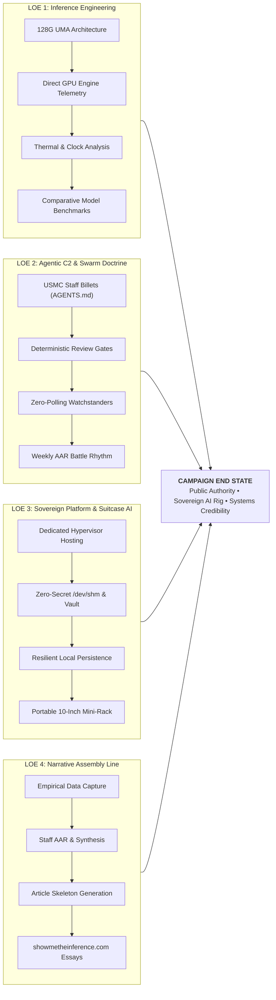
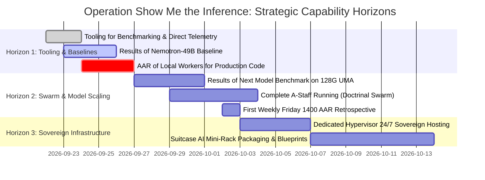

# Campaign Plan: Operation "Show Me the Inference"

```text
Document ID:        OPLAN-COLT-2026-SHOW-THE-INFERENCE
Document Type:      Strategic Portfolio Blueprint
Commander:          Nick Chalko
Upstream Authority: STRATDIR-THEATER-2026-SHOW-THE-INFERENCE (https://london.fog.chalko.com/Chalko/strategic-plans/src/branch/main/plans/THEATER_STRATEGY_SHOW_THE_INFERENCE.md)
Strategic Lead:     Margaret "Peggy" Carter (`strategic-plans/peggy` — Strategic Theater Director)
Operational Lead:   General Dwight D. "Ike" Eisenhower (`colt-cos` — Mayor / Executive Officer, Camp Colt)
Doctrinal Ref:      MCDP 1 (Warfighting), MCDP 1-0 (Operations), MCTP 3-30A (Command & Staff Action)
Master Brand:       Show Me the Inference (`https://showmetheinference.com`)
Target Cluster:     Camp Colt Sovereign AI Command Post & Suitcase AI Mini-Rack
```

---

## Executive Summary & Strategic Context

After 18 years building distributed systems and infrastructure at Google, corporate ANDAs and proprietary internal tooling (Borg, Piper, Spanner) leave little public footprint. Today’s software landscape has permanently shifted: **syntax generation is no longer the engineering bottleneck, and toy prompt-wrappers do not demonstrate technical authority.**

The combined mission of **Suitcase AI** and **Camp Colt** is to serve as a **living, public engineering portfolio for Nick Chalko**. It demonstrates mastery across three indispensable pillars of modern high-value computing:

1. **Inference Engineering & Hardware Sympathy:** Operating cutting-edge silicon (ASUS Ascent GX10 / NVIDIA Grace Blackwell GB10), tuning unified memory architectures (UMA), and extracting sub-millisecond kernel telemetry.
2. **Deterministic Agentic Orchestration:** Eliminating LLM supervisor thrashing and hallucinated task closure by adapting rigorous military command-and-control doctrine (USMC MCTP 3-30A) to autonomous agent swarms (the specific operational case and doctrinal framework for A-Staff will be worked out separately).
3. **Sovereign Systems Architecture:** Operating a local, portable 24/7 AI command post (Suitcase AI) with immutable baselines, zero plaintext secrets, and resilient local data persistence (with full air-gapped isolation as an aspirational horizon).

Every operational milestone in Camp Colt produces empirical receipts (telemetry timeseries, benchmarks, code, and architectural dossiers) that feed directly into deep-dive public essays on **`https://showmetheinference.com`**.

---

## I. Commander's Intent



### 1. Purpose (The "Why")

To decisively demonstrate Staff/Principal-level competence in modern AI systems engineering. The campaign generates public, verifiable proof that Nick Chalko can architect, deploy, tune, and orchestrate production-grade local foundation models and autonomous multi-agent battalions, operating increasingly without reliance on commercial cloud APIs.

### 2. Method (The "How")

We reject trivial "hello world" LLM wrappers in favor of hard-nosed systems engineering:

- **Hardware-Mechanical Sympathy:** Treat inference as an applied hardware engineering discipline—measuring physical unified memory contention, GPU streaming multiprocessor clocks, thermal throttling, and prefill vs. decode latency directly from the host.
- **Doctrinal Command & Control:** Treat agent swarms as distributed state machines governed by Marine Corps staff doctrine (MCTP 3-30A) to eliminate supervisor thrashing and context degradation.
- **The Mission-to-Post Pipeline:** Every tactical victory produces empirical data (Grafana snapshots, Prometheus timeseries, flamegraphs) that is packaged by the staff into publication-ready technical essays.

### 3. Strategic End State

1. **Public Technical Credibility:** `showmetheinference.com` is established as a grounded, authoritative reference for systems engineers, AI architects, and engineering leaders seeking empirical truth on local inference and multi-agent systems.
2. **The Sovereign Command Post (Suitcase AI):** A 10" mini-rack housing a self-sufficient, 24/7 agent factory operating with local inference, zero plaintext secrets, and native NVMe storage.
3. **Professional Demonstration:** A public portfolio demonstrating deep systems thinking, hands-on execution, and technical leadership across modern AI architectures.

---

## II. Center of Gravity (COG) Analysis

In Marine Corps campaign design, identifying the Center of Gravity (the primary source of moral or physical strength) ensures all tactical efforts reinforce the strategic goal:

- **Strategic Center of Gravity:** **Empirical Reproducibility ("The Receipts").**
  - _Rationale:_ Anyone on social media can claim to build AI agents or run local LLMs. Your competitive advantage is providing the exact configurations, raw timeseries telemetry curves, reproducible benchmarks, and architectural post-mortems that prove execution on real hardware.
- **Critical Capabilities Required:**
  1. _Silicon Observability:_ Direct extraction of GPU host telemetry (engine latency, memory allocation, clocks, thermals) bypassing edge gateway abstraction.
  2. _Swarm Stability:_ Autonomous agent coordination that runs continuously without supervisor thrashing, memory leaks, or context corruption.
  3. _Editorial Rhythm:_ Rapid translation of internal staff AARs and benchmark dossiers into polished, reader-friendly technical essays.

---

## III. Campaign Lines of Effort (LOEs)



---

### Line of Effort 1: Inference Engineering on Bare Metal

- **Strategic Objective:** Master and document the physical realities of running useful models on a 128G unified memory architecture.
- **Key Technical Battles:**
  - **Unified Memory (UMA) Management:** Characterizing unified memory constraints on silicon like the GB10; establishing precise utilization limits to protect OS kernel stability and host I/O buffers under peak KV-cache pressure.
  - **Dual-Tap Telemetry:** Pairing direct engine metrics from the inference host (prefill latency, decode time, VRAM KV cache, Radix prefix hits) with proxy timings to measure true operational overhead.
  - **Thermal & Throttling Limits:** Correlating streaming multiprocessor clocks with core temperatures to detect thermal clock step-downs under sustained multi-agent workloads.
- **Decisive Artifacts:**
  - Model evaluation dossiers for active workloads (starting with Nemotron-49B as our initial baseline, expanding as new architectures are evaluated).
  - Standardized, versioned benchmark datasets in `rigs/colt-results/benchmarks/`.

---

### Line of Effort 2: Agentic C2 & Swarm Doctrine

- **Strategic Objective:** Solve the core failure mode of autonomous agent swarms—supervisor thrashing and unverified task completion—by implementing military staff doctrine.
- **Key Technical Battles:**
  - **Watch Posture Tiers:** Formalizing the Always-On Core (`cos`, `mayor`, `s3`, `s6`), On-Demand Specialists (`s1`, `s2`, `s4`, `colt-sysadmin`), and Ephemeral Polecats.
  - **Deterministic Task Delegation:** Replacing manual session polling with structured, automated hand-offs and verifiable completion gates.
  - **Completed Staff Work Standard (MCTP 3-30A):** Forbidding superficial task closure; mandating empirical causal proofs and reproducible verification steps.
  - **Battle Rhythm Synchronization:** Daily Commander's Update Briefs (CUB) and weekly after-action reviews (AAR) to maintain operational alignment and tune friction points.
- **Decisive Artifacts:**
  - [`docs/SOP_WATCH_POSTURE.md`](file:///home/camp-colt-mayor-agent/colony/docs/SOP_WATCH_POSTURE.md)
  - Doctrine references in [`rigs/a-staff/references/`](file:///home/camp-colt-mayor-agent/colony/rigs/a-staff/references/) (`MCRP 3-10A.1`, `MCTP 3-30A`)
  - [`rigs/a-staff/plans/SOP_WEEKLY_TASK_FRICTION_AAR.md`](file:///home/camp-colt-mayor-agent/colony/rigs/a-staff/plans/SOP_WEEKLY_TASK_FRICTION_AAR.md)

---

### Line of Effort 3: Sovereign Platform & Suitcase AI

- **Strategic Objective:** Build and demonstrate an immutable, portable, local software factory operating inside a 10" mini-rack (with air-gapped isolation as an aspirational horizon).
- **Key Technical Battles:**
  - **Dedicated Hypervisor Infrastructure:** Hosting command-and-control workloads on dedicated hypervisors with immutable cloud-init baselines, eliminating laptop dependencies and host fragility.
  - **Clean Execution Baseline:** Fully automated cloud-init provisioning establishing unprivileged service identities with passwordless sudo for administration.
  - **Zero Plaintext Secrets:** Memory-backed `/dev/shm` credentials, vault-managed tokens, and strictly unprivileged POSIX identities across all agent roles.
  - **Local Persistence & SCM:** Local versioned ledgers and internal forge repositories operating self-reliantly on the local network.
- **Decisive Artifacts:**
  - Hypervisor infrastructure automation manifests (`provision/`).
  - `rigs/suitcase-ai/` portable mini-rack deployment plans.

---

### Line of Effort 4: The Narrative Assembly Line (`showmetheinference.com`)

- **Strategic Objective:** Seamlessly convert internal engineering victories into published essays, technical threads, and community field reports.
- **The Four-Stage Publishing Assembly Line:**
  1. **Telemetry Harvest (Tactical Level):** Workers execute beads and output raw timeseries, benchmark data, and telemetry captures into `rigs/colt-results/`.
  2. **Technical AAR Compilation (Operational Level):** Operational staff compile the technical dossier explaining failure modes, architectural trade-offs, and empirical metrics.
  3. **Editorial Article Skeleton (Staff Level):** Chief of Staff synthesizes the dossier into a structured, narrative blog post outline matching the _Show Me the Inference_ voice.
  4. **Commander Publication (Executive Level):** Commander reviews, infuses his 18-year Google perspective and personal voice, and publishes to `https://showmetheinference.com`.

---

## IV. Campaign Phasing & Capability Milestones



### Phase 1: Telemetry Tooling & Baseline Model Performance

- **Milestone 1.1: Tooling for Benchmarking & Observability:** Production-grade bracketed benchmark harness capturing direct GPU host metrics (prefill vs. decode latency, physical KV cache allocation, clock throttle events).
- **Milestone 1.2: Results of Nemotron-49B:** Comprehensive empirical profile of the initial baseline model running on 128G unified memory, documenting memory utilization headroom and operational trade-offs.
- **Milestone 1.3: AAR of Local Workers for Production Code:** First completed staff retrospective evaluating local model worker performance on real production coding tasks (pilot on `colt-utils`).
- **Publication Milestone 1:** Essay on bare-metal inference reality, unified memory management, and direct silicon telemetry.

### Phase 2: Swarm Coordination & Model Comparison

- **Milestone 2.1: Results of [Next Model] Benchmark:** Comparative empirical benchmark evaluating alternate open-weights architectures on 128G UMA under identical test suites.
- **Milestone 2.2: Complete A-Staff Running:** Autonomous multi-agent coordination operating stably under USMC staff doctrine (Always-on core + on-demand staff billets) with deterministic review gates.
- **Milestone 2.3: Weekly Friction Retrospectives:** Institutionalized weekly after-action reviews analyzing agent bottlenecks, token efficiency, and execution friction.
- **Publication Milestone 2:** Essay on governing multi-agent swarms with military staff doctrine to eliminate supervisor thrashing.

### Phase 3: Sovereign Mini-Rack & Hardware Portability

- **Milestone 3.1: Dedicated Hypervisor 24/7 Sovereign Hosting:** Stable, continuous operations hosted entirely on dedicated local hypervisors, fully severed from developer laptops.
- **Milestone 3.2: Suitcase AI Mini-Rack Deployment:** Portable 10" hardware deployment with reproducible cloud-init provisioning and local data persistence.
- **Milestone 3.3: Unit Economics & Replication Dossier:** Empirical cost-per-token and energy analysis comparing sovereign bare metal against commercial cloud APIs.
- **Publication Milestone 3:** Essay and open-source architecture blueprints for building a portable 24/7 sovereign AI factory.

---

## V. Doctrinal Command Hierarchy & Division of Command

As established in Theater Strategic Directive [STRATDIR-THEATER-2026-SHOW-THE-INFERENCE](https://london.fog.chalko.com/Chalko/strategic-plans/src/branch/main/plans/THEATER_STRATEGY_SHOW_THE_INFERENCE.md) (Section IV), command authority is distributed across three echelons:

1. **Strategic Theater Oversight (Director Peggy Carter / `strategic-plans`)**:
   - Maintains theater-level intent, brand positioning (`showmetheinference.com`), cross-town coordination (Laptop Town, Luna, Camp Colt), and architectural invariants.
   - Defines acceptance criteria and issues Strategic Directives / WARNORDs for candidate missions in the [Theater Mission & Target Registry](https://london.fog.chalko.com/Chalko/strategic-plans/src/branch/main/plans/THEATER_MISSION_AND_TARGET_REGISTRY.md).
   - Evaluates operational AARs against the strategic mission.
2. **Operational Command (General Dwight D. "Ike" Eisenhower / `colt-cos` & `a-staff`)**:
   - Translates upstream strategic directives into the operational campaign plan (`CAMPAIGN_PLAN_SHOW_THE_INFERENCE.md`).
   - Mobilizes Camp Colt staff sections to execute benchmarks, manage watch postures, and collect data.
   - Enforces the Completed Staff Work standard across all subordinate deliverables and fact sheets.
3. **Commander & Executive Author (Nick Chalko)**:
   - Holds final publication authority.
   - Infuses his 18-year Google systems perspective, narrative voice, and architectural insight into the empirical fact sheets assembled by the staff.

---

## VI. Staff Section Cognizance for the Campaign

| Staff Section                        | Campaign Cognizance & Deliverable Responsibilities                                                                                                 |
| :----------------------------------- | :------------------------------------------------------------------------------------------------------------------------------------------------- |
| **Chief of Staff (`colt-cos`)**      | Orchestrates campaign lines of effort, enforces Completed Staff Work, liaises with Commander, translates internal AARs into publication skeletons. |
| **Mayor (`mayor`)**                  | Maintains the Gas City town root, session scaffolding, `city.toml` mounting, and physical workspace hygiene; zero operational planning.            |
| **S-3 Operations (`s3-operations`)** | Manages the virtual Combat Operations Center (COC), decomposes operational epics into task beads, dispatches workers, enforces clean-tree gates.   |
| **S-6 Signal & Cyber (`s6-signal`)** | Oversees gateway routing, proxy sanitization, communications pipelines, TLS/PKI transit, and zero-secret commit audits.                            |
| **Platform SRE (`colt-sysadmin`)**   | Manages physical hypervisors, K8s cluster, Proxmox VE, storage pools, hardware telemetry (DCGM), and immutable cloud-init templates.               |
| **S-4 Logistics (`s4-logistics`)**   | Manages Gitea repository depots, storage quotas, token accounting, and ReadyLocker NVMe model weights.                                             |
| **S-1 Personnel (`s-1`)**            | Manages Non-Human Identity (NHI) mappings, RBAC permissions, and administrative workflows.                                                         |
| **S-2 Intelligence (`s-2`)**         | Executes codebase AST terrain indexing, technical runbook synthesis, and dependency vulnerability research.                                        |

---

## VII. Commander's Guidance & Operational Cadence

- **Publication Rhythm:** Weekly deep-dive technical essays on `showmetheinference.com` during the active campaign; transitioning to at least once a month following employment transition.
- **Focus on Ground Truth:** Every essay must be anchored in empirical receipts—reproducible configs, raw timeseries telemetry, and verified code execution rather than abstract speculation.
- **Separation of Concerns:** High-level campaign doctrine sets the strategic objective and Commander's Intent; technical implementation details and tactical task beads remain encapsulated in operational staff plans (`a-staff`).
