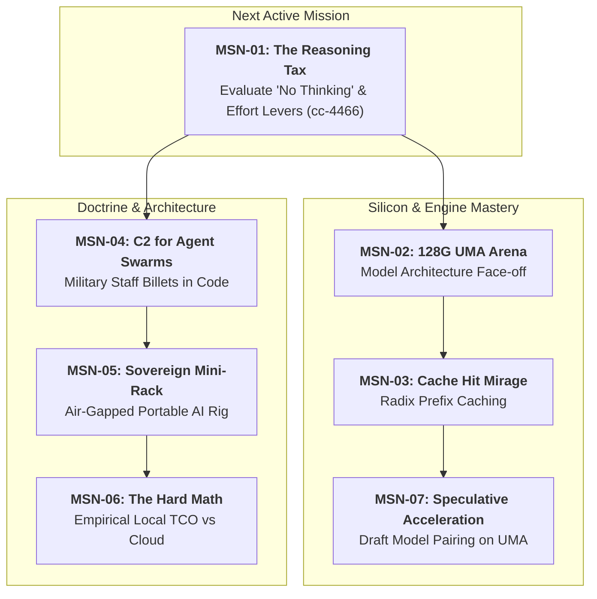

# Strategic Portfolio Roadmap: Future Target Missions & Dispatches

```text
Document ID:     PLAN-ASTAFF-FUTURE-MISSIONS-2026-09-26
Classification:  UNCLASSIFIED / OPERATIONAL STRATEGY
Commander:       Nick Chalko
Author:          Chief of Staff (`colt-cos`), Camp Colt
Doctrinal Ref:   MCDP 1 (Warfighting), MCTP 3-30A (Command & Staff Action)
Parent Plan:     OPLAN-COLT-2026-SHOW-THE-INFERENCE (Campaign Plan)
Target Platform: Show Me the Inference (`https://showmetheinference.com`)
Target Cluster:  Camp Colt Sovereign AI Command Post (ASUS Ascent GX10 / NVIDIA GB10)
```

---

## I. Strategic Purpose & Editorial Alignment

All missions across Camp Colt serve a dual purpose mandated by the **Commander's Planning Guidance (CPG)**:

1. **Operational Dominance**: Build, harden, and master sovereign multi-agent engineering workflows on bare-metal silicon.
2. **Empirical Narrative Receipts**: Produce rigorous, reproducible benchmark data, timeseries telemetry, and architectural blueprints that directly anchor technical dispatches on **`https://showmetheinference.com`**.

Per the Commander's core doctrine:

- **Empirical Receipts Over Assertions**: No marketing fluff; every claim is proven with Grafana timeseries, DCGM silicon thermals, vLLM engine histograms, and verified test suites.
- **Zero Agent Ghostwriting**: Staff plans, benchmarks, and captures raw telemetry dossiers; the Commander infuses his 18-year Google distributed systems perspective and personal voice into every published dispatch.

---

## II. Master Target Missions Matrix

| Mission ID | Mission Codename                 | Strategic Pillar            | Target Hardware & Model                                       | Primary Empirical Receipts                                       | Blog Post Title & Theme                                                                           | Status / Bead                                                             |
| :--------- | :------------------------------- | :-------------------------- | :------------------------------------------------------------ | :--------------------------------------------------------------- | :------------------------------------------------------------------------------------------------ | :------------------------------------------------------------------------ |
| **MSN-01** | **The Reasoning Tax**            | Inference Engineering       | GB10 UMA<br>`nemotron-49b`                                    | Latency breakdown, TTFT, token delta, code pass rate             | _When Thinking Hurts: Benchmarking Reasoning Effort and Tool Calling Latency on Local 49B Models_ | **Active**<br>[`cc-4466`](file:///home/camp-colt-mayor-agent/colony) (P1) |
| **MSN-02** | **The 128G UMA Arena**           | Inference Engineering       | GB10 UMA<br>`nemotron-49b` vs `qwen-32b` vs `deepseek-r1-32b` | Peak TPS, prefill speed, KV cache footprint, thermal slope       | _Battle of the Local Titans: 32B vs 49B vs 70B on 128GB Unified Memory_                           | **Planned**<br>Phase 2 Baseline                                           |
| **MSN-03** | **The Cache Hit Mirage**         | Inference Engineering       | GB10 UMA<br>vLLM Radix Engine                                 | Radix prefix hit %, memory fragmentation, inter-agent latency    | _Why Your Multi-Agent Swarm Is Busting the KV Cache (And How to Fix It)_                          | **Planned**                                                               |
| **MSN-04** | **C2 for Agent Swarms**          | Deterministic Orchestration | Multi-node Gas City<br>Staff billets                          | Watchstander event loops, zero-polling receipts, zero-thrash AAR | _Running AI Agent Swarms Like a Marine Combat Operations Center_                                  | **Underway**<br>Institutionalized                                         |
| **MSN-05** | **The Sovereign Command Post**   | Sovereign Infrastructure    | Mini-Rack Proxmox<br>ASUS Ascent GX10                         | Zero-secret `/dev/shm`, Dolt immutable state, air-gap replay     | _Building a Sovereign 24/7 AI Command Post in a Suitcase_                                         | **Planned**<br>Horizon 3                                                  |
| **MSN-06** | **The Hard Math of Sovereignty** | Systems Economics           | Kill-A-Watt PDU<br>DCGM Joules vs Cloud APIs                  | Watts/token, hardware payback curve, local vs API spend          | _Show Me the Receipts: The Real Cost-Per-Token of Local Silicon vs Cloud APIs_                    | **Planned**                                                               |
| **MSN-07** | **Speculative Acceleration**     | Inference Engineering       | GB10 UMA<br>Target + Draft models                             | Acceptance rate %, decode acceleration factor, latency drop      | _Turbocharging Local Coding Agents: Speculative Decoding on Unified Memory_                       | **Backlog**                                                               |

---

## III. Detailed Mission Operational Profiles



---

### Mission 01: The Reasoning Tax — "No Thinking" vs. Unconstrained Reasoning

- **Parent Task Bead**: [`cc-4466`](file:///home/camp-colt-mayor-agent/colony) (P1 Spike)
- **Triggering Anomaly**: Forensics on [`cc-71go`](file:///home/camp-colt-mayor-agent/colony) revealed that an agent worker generated 15,511 tokens in a single unbroken turn ($66.01\text{ minutes}$) due to unbounded internal `<think>` generation during a compiler bootstrap prompt.
- **Core Technical Question**: Does extended reasoning improve agentic coding pass rates, or does it impose an unsustainable latency and compute tax compared to concise, reactive tool calling with compiler feedback?
- **Experimental Matrix**:
  1. _Unconstrained Reasoning (Baseline)_: Standard prompt without thinking constraints.
  2. _Reasoning Budget Caps_: Enforcing token limits (`max_thinking_tokens` or `reasoning_effort=low`).
  3. _Thinking Suppression ("No Thinking")_: Explicit system prompt guardrails instructing the model to emit tool calls immediately with zero preamble, testing chat template overrides.
- **Empirical Receipts to Capture**:
  - TTFT, tokens/sec, and total turn latency across 10 identical code modification tasks.
  - Total token consumption (prefill vs generation).
  - First-pass compiler pass rate vs multi-turn feedback convergence rate.
  - GPU thermal and energy draw per successful turn.
- **Blog Post Deliverable**: _When Thinking Hurts: Benchmarking Reasoning Effort and Tool Calling Latency on Local 49B Models_.

---

### Mission 02: The 128G UMA Arena — Comparative Open-Weights Efficiency

- **Strategic Objective**: Determine the optimal architectural sweet spot for local 24/7 coding agents on 128GB Unified Memory (Grace Blackwell GB10).
- **Models Tested**:
  1. `nvidia/llama-3.3-nemotron-super-49b-v1.5` (Current baseline, FP8 / AWQ)
  2. `Qwen/Qwen2.5-Coder-32B-Instruct` (Dense coding champion)
  3. `deepseek-ai/DeepSeek-R1-Distill-Qwen-32B` / `70B` (Reasoning-distilled alternative)
- **Key Technical Battles**:
  - Unified memory headroom: Evaluating KV-cache capacity before hitting OS buffer eviction.
  - Context scaling: Ingestion speed and TTFT degradation from 4k to 32k context windows.
  - Tool-calling determinism: JSON schema adherence across complex multi-tool calls.
- **Empirical Receipts**:
  - Side-by-side Grafana wide-metrics dashboards.
  - Standardized benchmark scorecards across the `colt-utils` test harness.
- **Blog Post Deliverable**: _Battle of the Local Titans: 32B vs 49B vs 70B on 128GB Unified Memory_.

---

### Mission 03: The Cache Hit Mirage — Radix Prefix Caching in Multi-Agent Swarms

- **Core Technical Question**: How does vLLM's Radix tree prefix caching behave when 6+ heterogeneous agent sessions concurrently query the engine with divergent prompts?
- **Hypothesis**: Multi-agent swarms inadvertently thrash vLLM's prefix cache because divergent agent system prompts and history order cause constant prefix tree eviction, negating prefill acceleration.
- **Experimental Design**:
  - Measure cache hit rates under uncoordinated prompting.
  - Implement strict hierarchical prompt templating (standardized base system prompt shared across all staff billets).
  - Measure prefill latency reduction and GPU memory savings.
- **Empirical Receipts**:
  - `vllm:prefix_cache_hit_rate` timeseries during active multi-agent slings.
  - Prefill duration comparisons with warm vs cold cache.
- **Blog Post Deliverable**: _Why Your Multi-Agent Swarm Is Busting the KV Cache (And How to Fix It)_.

---

### Mission 04: Military Command & Control for Autonomous Swarms

- **Core Technical Question**: Can classical military command doctrine (USMC MCTP 3-30A) eliminate LLM supervisor thrashing and hallucinated task closure?
- **Doctrine Under Test**:
  - Always-On Command Watch (`cos`, `mayor`, `s3-operations`, `s6-signal`) vs Ephemeral Task Workers (Rig Polecats).
  - Strict Completed Staff Work standards: No task marked complete without empirical test verification.
  - Asynchronous message passing via Dolt-backed beads without polling loops.
- **Empirical Receipts**:
  - Audit logs of zero infinite loops across 100+ executed task beads.
  - Session uptime, memory stability, and zero zombie process counts in Gas City.
- **Blog Post Deliverable**: _Running AI Agent Swarms Like a Marine Combat Operations Center_.

---

### Mission 05: The Sovereign 24/7 Command Post in a Suitcase

- **Core Technical Question**: What does it take to run an enterprise-grade AI agent factory on a portable, sovereign mini-rack that can operate in an RV, remote field office, or disconnected homelab?
- **Architectural Stack**:
  - ASUS Ascent GX10 GB10 (Inference Engine) + Minisforum Mini-PC (Hypervisor & Orchestration).
  - Proxmox VE, K8s (kube-prometheus-stack, Flux CD, Gitea, LiteLLM).
  - Dolt database persistence for agent task states.
  - HashCorp Vault with `/dev/shm` ephemeral secret injection.
- **Empirical Receipts**:
  - Network severance test: Sever upstream internet connection and execute full coding task cycle locally.
  - Cold-boot recovery time and cloud-init provisioning receipts.
- **Blog Post Deliverable**: _Building a Sovereign 24/7 AI Command Post in a Suitcase_.

---

### Mission 06: The Hard Math of Sovereignty — Empirical TCO

- **Core Technical Question**: When does sovereign bare-metal silicon actually beat commercial cloud APIs (Claude 3.5 Sonnet, GPT-4o) on real dollars?
- **Telemetry Setup**:
  - Hardware power draw tracked at wall plug via smart PDU + DCGM GPU wattage telemetry.
  - Real electricity cost ($/kWh) calculated over 1 million generated tokens.
  - Amortization of the ASUS Ascent GX10 hardware vs commercial API pricing.
- **Empirical Receipts**:
  - Joules per generated token.
  - Total Monthly Cost curve as a function of swarm token volume.
- **Blog Post Deliverable**: _Show Me the Receipts: The Real Cost-Per-Token of Local Silicon vs Cloud APIs_.

---

### Mission 07: Speculative Acceleration on Unified Memory

- **Core Technical Question**: Can we double local agent generation throughput on Grace Blackwell GB10 by pairing a 1.5B/7B draft model with our 32B/49B target models?
- **Hardware Sympathy**:
  - UMA allows both target and draft model weights to reside in high-speed unified memory without PCIe transfer bottlenecks.
  - Measure acceptance rates and verify that speculative drafting introduces zero degradation in code compilation pass rates.
- **Blog Post Deliverable**: _Turbocharging Local Coding Agents: Speculative Decoding on Unified Memory_.

---

## IV. Execution Sequence & Battle Rhythm

```text
MSN-01 (Nemotron Effort Levers)  ──►  Blog Post #2
      │
      ▼
MSN-02 (128G UMA Model Arena)    ──►  Blog Post #3
      │
      ▼
MSN-04 (Military Swarm C2)       ──►  Blog Post #4
      │
      ▼
MSN-06 (Empirical Silicon TCO)   ──►  Blog Post #5
```

Every mission follows the four-step production gate:

1. **Empirical Execution**: Task beads executed by S-3 / Platform SRE / Polecats with raw telemetry.
2. **Staff AAR & Synthesis**: Technical dossier compiled in `rigs/a-staff/plans/`.
3. **Article Skeleton**: Chief of Staff prepares structured outline with embedded Grafana charts.
4. **Commander Publication**: Commander reviews, infuses his authentic voice, and publishes to `showmetheinference.com`.
