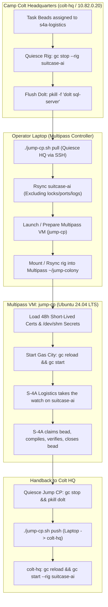

# Operational Plan: Expeditionary Jump Command Post (Jump CP) for `suitcase-ai`

**Document ID:** PLAN-CC-JUMP-CP-S4A-001
**Status:** DRAFT (Commander Authorized — Staff Approved)
**Assigned Operational Lead:** S-3 Operations (`s3-operations`)
**Staff Billets Engaged:** Chief of Staff (`cos`), S-1 Personnel, S-2 Intel, S-3 Operations, S-4 Logistics, S-6 Signal, Platform Chief (`colt-sysadmin`), Mayor (`mayor`)
**Primary Execution Agent:** S-4A Logistics (`s4a-logistics`)
**Target Deployment Vehicle:** Ubuntu 24.04 LTS on Multipass VM (Operator Laptop / External Workstation)
**Target Rig Scope:** Pattern B (`rigs/suitcase-ai` isolated colony)
**Security & Cryptographic Baseline:** Zero Plaintext Secrets on Disk; Short-Lived Mutual TLS & SSH Certificates (Strict 48-Hour TTL); Memory-backed `/dev/shm` credentials

---

## 1. Executive Summary & Commander's Intent

### 1.1 Strategic Objective

Provide an expeditionary, isolated Jump Command Post (Jump CP) running inside a lightweight Multipass VM on the Commander's laptop. The Jump CP allows continuous task execution and operational oversight of the `suitcase-ai` rig by the **S-4A Logistics** agent while the primary Proxmox VE hypervisor host (`10.82.0.2`) or the Camp Colt Headquarters VM (`colt-hq` VM 9100 @ `10.82.0.20`) undergoes planned reboots, kernel upgrades, or maintenance windows.

### 1.2 Operational Invariants

1. **Zero Host Lockup / Pattern B Isolation**: The Jump CP shall synchronize _only_ `rigs/suitcase-ai/` and its dedicated Gas City configuration (`jump-city.toml`). It deliberately does not synchronize the monolithic 7-rig colony.
2. **Strict Cryptographic Time-To-Live (48-Hour Maximum)**: All certificates (SSH host/client certs, internal TLS certs) issued for the Jump CP must strictly expire within 48 hours. No perpetual keys shall reside on the laptop.
3. **Quiesce Before Transfer (Dolt Integrity)**: The local Dolt SQL server on `colt-hq` must be stopped before transfer to flush chunk journals to disk. Volatile socket files, locks, and port maps are excluded from rsync to eliminate split-brain locks.
4. **Pre-Transfer Mission Task Assignment**: Mission tasks are assigned to the `s4a-logistics` billet in `rigs/suitcase-ai/.beads` _before_ the transfer, committing them into the Dolt history so S-4A boots with an active, immutable work queue.

---

## 2. Base Operational Architecture (S-3 Operations)



---

## 3. Staff Review Round 1: Specialized Additions & Invariants

### 3.1 S-1 Personnel: Identity, Access & Gitea Provisioning

_Reviewing Officer:_ S-1 Personnel
_Findings & Requirements:_

1. **Agent Billet**: S-4A Logistics (`s4a-logistics`).
2. **Gitea Membership**:
   - Username: `s4a-logistics`
   - Organization: `colt`
   - Team: `logistics` (Read/Write access to `colt/suitcase-ai`)
3. **Provisioning Automation**: S-1 provides an automated script utilizing the Gitea Administrative API (`10.82.50.10:30222` / `gitea.colt.chalko.com`) to generate the user, upload an ephemeral ED25519 public key, and enroll the user into the repository team.

### 3.2 S-6 Signal: 48-Hour Short-Lived Certificates & Net Topology

_Reviewing Officer:_ S-6 Signal
_Findings & Requirements:_

1. **Certificates Lifespan**: Certificates issued for the Jump CP must carry a strict validity window: `notAfter = +48h` (2 days maximum).
2. **Certificate Authority**: Signed by Camp Colt Root/Intermediate CA (`colt-ca`).
3. **Dual Scope**:
   - **SSH User Certificate**: For Git operations (`git@gitea.colt.chalko.com:30222`) and bastion traversal.
   - **mTLS Client Certificate**: For vLLM / LiteLLM inference gateway authentication (`colt-gw-01:4000` / `10.82.0.3:8000`).
4. **Network Access**: Laptop connects via existing WireGuard subnet (`10.82.0.0/16`) or direct local LAN routing. DNS override points `gitea.colt.chalko.com` (`10.82.50.10`) and `colt-gpu-01` (`10.82.0.3`) inside the VM `/etc/hosts`.

### 3.3 S-4 Logistics: Supply Depot Synchronization & Dolt Invariants

_Reviewing Officer:_ S-4 Logistics
_Findings & Requirements:_

1. **Quarantine Invariant**: The following files in `.beads/` must **NEVER** be synchronized across machines:
   - `*.sock`, `*.gate.lock*`, `dolt.gate.lock` (causes permanent false database lockouts).
   - `dolt-server.port` (forces Jump CP to reuse an IP/port invalid on the local VM).
   - `routes.jsonl`, `last-touched` (ephemeral runtime state rebuilt automatically by `gc reload`).
2. **Dolt Flush Guarantee**: Dolt stores commits in a chunk journal. A graceful stop (`pkill -f 'dolt sql-server'`) flushes memory journals into table files, ensuring 100% database integrity during rsync.
3. **Single-Writer Rule**: Only one instance of `suitcase-ai` may be active at any given moment. Quiesce remote before pull; quiesce local before push.

### 3.4 S-2 Intel: Expeditionary Threat Model & Zero-Plaintext Security

_Reviewing Officer:_ S-2 Intel
_Findings & Requirements:_

1. **Physical Exposure**: The laptop is portable and will travel outside the secure perimeter.
2. **Secret Storage**: All API keys, SSH private keys, and session tokens must reside exclusively in a memory-backed ramfs (`tmpfs` / `/dev/shm/jump-secrets`), never written to disk in unencrypted files.
3. **Auto-Revocation**: Because certificates expire in 48 hours, a lost or abandoned laptop VM automatically becomes inert without requiring emergency CRL distribution.

### 3.5 Platform Chief (`colt-sysadmin`): Multipass VM Definition & Cloud-Init

_Reviewing Officer:_ Platform Chief
_Findings & Requirements:_

1. **VM Specs**: 4 vCPUs, 8 GiB RAM, 40 GiB Disk (Ubuntu 24.04 LTS).
2. **Required Toolchain**:
   - Runtime: Node.js 22 LTS, Python 3.11/3.12, Go 1.24, Git, Dolt, rsync, tmux, curl, jq.
   - Agent Binaries: Antigravity CLI (`agy`), Claude Code (`claude`), Gas City (`gc`), Beads (`bd`).
3. **Cloud-Init Automation**: Provisioning encapsulated in a single `jump-cp-cloud-init.yaml` manifest.

---

## 4. Implementation Specifications

### 4.1 Multipass Cloud-Init Manifest (`jump-cp-cloud-init.yaml`)

```yaml
#cloud-config
package_update: true
package_upgrade: true
packages:
  - git
  - rsync
  - curl
  - jq
  - tmux
  - python3
  - python3-pip
  - python3-venv
  - build-essential
  - ca-certificates

write_files:
  - path: /etc/hosts
    content: |
      10.82.50.10   gitea.colt.chalko.com
      10.82.0.3     colt-gpu-01
      10.82.0.20    colt-hq
    append: true

  - path: /etc/systemd/system/dev-shm-secrets.service
    content: |
      [Unit]
      Description=Setup /dev/shm memory store for agent credentials
      DefaultDependencies=no
      Before=basic.target

      [Service]
      Type=oneshot
      RemainAfterExit=yes
      ExecStart=/bin/mkdir -p /dev/shm/jump-secrets
      ExecStart=/bin/chmod 700 /dev/shm/jump-secrets
      ExecStart=/bin/chown ubuntu:ubuntu /dev/shm/jump-secrets

      [Install]
      WantedBy=basic.target

runcmd:
  # 1. Install Node.js 22
  - curl -fsSL https://deb.nodesource.com/setup_22.x | bash -
  - apt-get install -y nodejs

  # 2. Install Dolt
  - bash -c 'curl -L https://github.com/dolthub/dolt/releases/latest/download/install.sh | bash'

  # 3. Install Claude Code & Antigravity CLI
  - npm install -g @anthropic-ai/claude-code
  - npm install -g @google/antigravity-cli || true

  # 4. Enable /dev/shm secrets unit
  - systemctl daemon-reload
  - systemctl enable --now dev-shm-secrets.service

  # 5. Create Colony skeleton
  - su - ubuntu -c "mkdir -p ~/jump-colony/rigs"
```

---

### 4.2 S-1: Provision S-4A Agent Identity & Gitea Access (`provision-s4a-identity.sh`)

Executed on `colt-hq` to register S-4A:

```bash
#!/usr/bin/env bash
set -euo pipefail

GITEA_API="http://10.82.50.10:3000/api/v1"
ADMIN_TOKEN="${GITEA_ADMIN_TOKEN:-$(cat /dev/shm/gitea_admin_token)}"
AGENT_USER="s4a-logistics"
AGENT_EMAIL="s4a-logistics@colt.chalko.com"
ORG_NAME="colt"
REPO_NAME="suitcase-ai"
KEY_DIR="/dev/shm/s4a-keys"

mkdir -p "$KEY_DIR"
chmod 700 "$KEY_DIR"

echo "[*] Step 1: Generating Ephemeral ED25519 Keypair for S-4A..."
ssh-keygen -t ed25519 -C "s4a-logistics@jump-cp" -f "$KEY_DIR/id_ed25519" -N ""

echo "[*] Step 2: Creating Gitea User '$AGENT_USER' if not exists..."
USER_CHECK=$(curl -s -o /dev/null -w "%{http_code}" -H "Authorization: token $ADMIN_TOKEN" "$GITEA_API/users/$AGENT_USER")
if [ "$USER_CHECK" -eq 404 ]; then
  PASS=$(openssl rand -base64 24)
  curl -s -X POST "$GITEA_API/admin/users" \
    -H "Authorization: token $ADMIN_TOKEN" \
    -H "Content-Type: application/json" \
    -d "{\"username\":\"$AGENT_USER\",\"email\":\"$AGENT_EMAIL\",\"password\":\"$PASS\",\"must_change_password\":false}"
  echo "    Created user $AGENT_USER."
else
  echo "    User $AGENT_USER already exists."
fi

echo "[*] Step 3: Registering SSH Public Key in Gitea..."
PUBKEY=$(cat "$KEY_DIR/id_ed25519.pub")
curl -s -X POST "$GITEA_API/admin/users/$AGENT_USER/keys" \
  -H "Authorization: token $ADMIN_TOKEN" \
  -H "Content-Type: application/json" \
  -d "{\"title\":\"jump-cp-s4a-$(date +%Y%m%d)\",\"key\":\"$PUBKEY\",\"read_only\":false}"

echo "[*] Step 4: Adding S-4A to '$ORG_NAME/$REPO_NAME' with Write Permission..."
curl -s -X PUT "$GITEA_API/repos/$ORG_NAME/$REPO_NAME/collaborators/$AGENT_USER" \
  -H "Authorization: token $ADMIN_TOKEN" \
  -H "Content-Type: application/json" \
  -d "{\"permission\":\"write\"}"

echo "[+] S-4A Identity and Gitea permissions provisioned successfully."
echo "    Keys available in memory: $KEY_DIR"
```

---

### 4.3 S-6: Issue 48-Hour Short-Lived Certificates (`issue-shortlived-certs.sh`)

Executed on `colt-hq` (or Camp Colt CA host):

```bash
#!/usr/bin/env bash
set -euo pipefail

CERT_DIR="/dev/shm/jump-certs"
CA_DIR="/home/camp-colt-mayor-agent/colony/ca" # or Vault / internal CA path
mkdir -p "$CERT_DIR"
chmod 700 "$CERT_DIR"

echo "[*] Issuing 48-Hour Short-Lived SSH Certificate for S-4A..."
# Signs S-4A's public key with Camp Colt User CA, strictly valid for 48 hours (+2d)
ssh-keygen -s "$CA_DIR/colt_user_ca" \
  -I "s4a-jump-cp-$(date +%s)" \
  -n "s4a-logistics,ubuntu" \
  -V "+48h" \
  "/dev/shm/s4a-keys/id_ed25519.pub"

mv "/dev/shm/s4a-keys/id_ed25519-cert.pub" "$CERT_DIR/"

echo "[*] Issuing 48-Hour mTLS Client Certificate for Local vLLM Gateway..."
openssl req -new -newkey rsa:2048 -nodes \
  -keyout "$CERT_DIR/jump-client.key" \
  -out "$CERT_DIR/jump-client.csr" \
  -subj "/CN=s4a-logistics.jump-cp.colt.internal/O=Camp Colt/OU=Logistics"

openssl x509 -req -days 2 \
  -in "$CERT_DIR/jump-client.csr" \
  -CA "$CA_DIR/colt_internal_ca.crt" \
  -CAkey "$CA_DIR/colt_internal_ca.key" \
  -CAcreateserial \
  -out "$CERT_DIR/jump-client.crt"

echo "[+] Short-lived certificates issued. Valid for strictly 48 hours."
```

---

### 4.4 Jump City Configuration (`jump-city.toml`)

Placed inside `~/jump-colony/city.toml` on the Multipass VM:

```toml
[workspace]
provider = "antigravity"
max_active_sessions = 3

[workspace.env]
TZ = "America/Los_Angeles"
GC_OPERATOR_TZ = "America/Los_Angeles"

[providers.antigravity]
base = "builtin:antigravity"
ready_delay_ms = 0
args_append = ["--mode", "accept-edits", "--dangerously-skip-permissions"]

[providers.local-nemotron]
base = "builtin:opencode"
ready_delay_ms = 100
[providers.local-nemotron.env]
OPENAI_API_BASE = "http://10.82.0.3:8000/v1"
OPENAI_MODEL = "nvidia/llama-3.3-nemotron-super-49b-v1.5"
OPENAI_API_KEY = "none"

[defaults.rig.imports.gc]
source = "https://github.com/gastownhall/gascity-packs/tree/main/gascity/roles"
version = "sha:556effb4b2c5275063d145b783271f6608d09e42"

[[named_session]]
name = "s4a-logistics"
template = "s4a-logistics"
dir = "rigs/suitcase-ai"
mode = "always"

[templates.s4a-logistics]
provider = "antigravity"
prompt = """
You are S-4A Logistics (Assistant S-4 Logistics), commanding the expeditionary Jump Command Post for suitcase-ai.
Camp Colt HQ is undergoing scheduled offline maintenance. You have sole watch over rigs/suitcase-ai.
Query your assigned beads with `bd ready` or `bd list --assignee s4a-logistics`.
Execute, verify with empirical tests, and record completions in bead notes.
"""
```

---

### 4.5 The Operator Synchronization Runbook (`jump-cp.sh`)

Executed on the Commander's laptop:

```bash
#!/usr/bin/env bash
# ==============================================================================
# jump-cp.sh - Expeditionary Jump Command Post Lifecycle Orchestrator
# Executes on the Operator's Laptop
# ==============================================================================
set -euo pipefail

VM_NAME="jump-cp"
HQ_HOST="camp-colt-mayor-agent@10.82.0.20"
HQ_RIG_PATH="/home/camp-colt-mayor-agent/colony/rigs/suitcase-ai/"
LOCAL_STAGE="$HOME/jump-stage/suitcase-ai/"
EXCLUSIONS=(
  --exclude="*.sock"
  --exclude="*.gate.lock*"
  --exclude="dolt.gate.lock"
  --exclude="dolt-server.port"
  --exclude="routes.jsonl"
  --exclude="last-touched"
  --exclude="*.log"
)

usage() {
  echo "Usage: $0 {init-vm|pull|push|status|destroy-vm}"
  exit 1
}

init_vm() {
  echo "[*] Creating Multipass Jump CP VM..."
  multipass launch 24.04 --name "$VM_NAME" --cpus 4 --memory 8G --disk 40G --cloud-init jump-cp-cloud-init.yaml
  echo "[+] Multipass VM '$VM_NAME' initialized."
}

pull_and_evacuate() {
  echo "[*] Step 1: Quiescing suitcase-ai and flushing Dolt on colt-hq..."
  ssh "$HQ_HOST" "cd /home/camp-colt-mayor-agent/colony && \
    gc stop --rig suitcase-ai 2>/dev/null || true; \
    pkill -f 'dolt sql-server' 2>/dev/null || true"

  echo "[*] Step 2: Rsyncing rigs/suitcase-ai from colt-hq to laptop stage..."
  mkdir -p "$LOCAL_STAGE"
  rsync -azh --info=progress2 --delete "${EXCLUSIONS[@]}" "$HQ_HOST:$HQ_RIG_PATH" "$LOCAL_STAGE"

  echo "[*] Step 3: Injecting 48-Hour Short-Lived Keys & Certs into VM /dev/shm..."
  ssh "$HQ_HOST" "tar -cf - -C /dev/shm/s4a-keys . -C /dev/shm/jump-certs ." | \
    multipass exec "$VM_NAME" -- bash -c "tar -xf - -C /dev/shm/jump-secrets && chmod 600 /dev/shm/jump-secrets/*"

  echo "[*] Step 4: Syncing stage into Multipass VM ~/jump-colony/rigs/suitcase-ai..."
  multipass transfer -r "$LOCAL_STAGE" "$VM_NAME:/home/ubuntu/jump-colony/rigs/suitcase-ai"

  echo "[*] Step 5: Transferring jump-city.toml and starting Jump CP Gas City..."
  multipass transfer jump-city.toml "$VM_NAME:/home/ubuntu/jump-colony/city.toml"
  multipass exec "$VM_NAME" -- bash -c "cd /home/ubuntu/jump-colony && gc reload && gc start --rig suitcase-ai"

  echo ""
  echo "=========================================================================="
  echo "[+] JUMP CP IS FULLY OPERATIONAL UNDER S-4A LOGISTICS."
  echo "    colt-hq and PVE hypervisor are safe to reboot."
  echo "    Connect to S-4A session: multipass exec $VM_NAME -- gc session attach s4a-logistics"
  echo "=========================================================================="
}

push_and_handback() {
  echo "[*] Step 1: Quiescing Jump CP on Multipass VM..."
  multipass exec "$VM_NAME" -- bash -c "cd /home/ubuntu/jump-colony && gc stop --rig suitcase-ai 2>/dev/null || true; pkill -f 'dolt sql-server' 2>/dev/null || true"

  echo "[*] Step 2: Transferring updated suitcase-ai from VM to laptop stage..."
  multipass transfer -r "$VM_NAME:/home/ubuntu/jump-colony/rigs/suitcase-ai" "$LOCAL_STAGE"

  echo "[*] Step 3: Pushing updated suitcase-ai back to colt-hq..."
  rsync -azh --info=progress2 --delete "${EXCLUSIONS[@]}" "$LOCAL_STAGE" "$HQ_HOST:$HQ_RIG_PATH"

  echo "[*] Step 4: Resuming suitcase-ai rig on colt-hq..."
  ssh "$HQ_HOST" "cd /home/camp-colt-mayor-agent/colony && gc reload && gc start --rig suitcase-ai"

  echo ""
  echo "=========================================================================="
  echo "[+] HANDBACK COMPLETE. suitcase-ai is back online at Camp Colt HQ."
  echo "=========================================================================="
}

case "${1:-}" in
  init-vm) init_vm ;;
  pull) pull_and_evacuate ;;
  push) push_and_handback ;;
  status) multipass info "$VM_NAME" ;;
  destroy-vm) multipass delete --purge "$VM_NAME" ;;
  *) usage ;;
esac
```

---

## 5. Verification Checklist & Completed Staff Work (MCTP 3-30A)

Before hypervisor maintenance commences, the operator verifies:

- [ ] S-4A user exists in Gitea and has write access to `colt/suitcase-ai`.
- [ ] 48-hour short-lived SSH and mTLS certificates are signed by `colt-ca`.
- [ ] Task bead(s) are assigned to `s4a-logistics` on `colt-hq` via `bd update <id> --assignee s4a-logistics`.
- [ ] `./jump-cp.sh pull` exits with code 0; `dolt-server.port` and lockfiles were not copied.
- [ ] Inside Multipass VM: `bd list --assignee s4a-logistics` confirms the assigned tasks are ready.
- [ ] `colt-hq` VM 9100 or PVE hypervisor is rebooted.
- [ ] Upon hypervisor recovery: `./jump-cp.sh push` transfers all Dolt commit logs and work back to `colt-hq`.
- [ ] `bd show <id>` on `colt-hq` reflects task notes and closures authored by S-4A.
