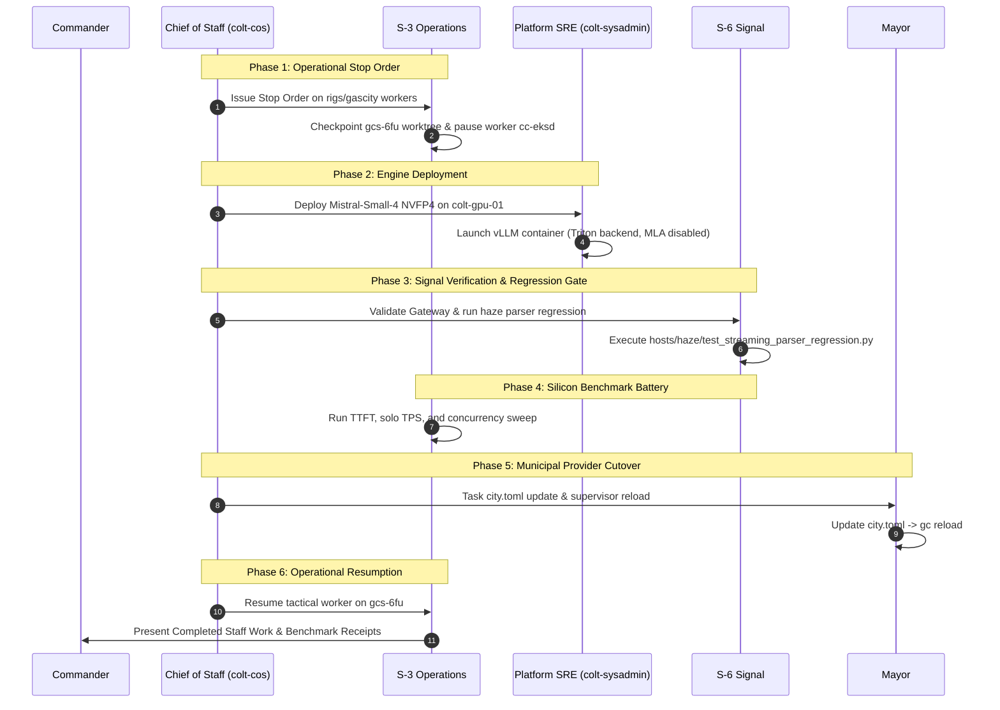

# Operational Architecture Plan: Transition to Mistral-Small-4-119B on Grace Blackwell GB10

```text
Document ID:     PLAN-OPS-2026-MISTRAL-SMALL-4-TRANSITION
Document Type:   Operational Transition & Silicon Benchmark Plan
Author / Billet: Chief of Staff (`colt-cos`), Camp Colt
Authority:       Commander's Directive (Post-Lunch Review) & MCTP 3-30A
Target Hardware: ASUS Ascent GX10 (NVIDIA Grace Blackwell GB10 @ 10.82.0.3:8000)
Status:          PROPOSED (Completed Staff Work — Disseminated for Review)
```

---

## 1. Executive Summary & Commander's Intent

### 1.1 Operational Problem Statement

Tactical workers operating on `rigs/gascity` under S-6 oversight (notably worker `cc-eksd` on Issue #5732 / `gcs-6fu`) have experienced repeated friction, tool-calling parsing failures, and execution stalls under the incumbent model profile (`nvidia/llama-3.3-nemotron-super-49b-v1.5`).

Specific failure modes identified:

1. **Tool-Call JSON Parser Brittleness:** Complex multi-line Go code patches containing nested curly braces and escape sequences repeatedly broke standard streaming regex extractors, triggering execution timeouts.
2. **Context Compression & Latency Tradeoffs:** Balancing reasoning effort against context length and throughput constrained worker velocity on complex multi-file tasks.

### 1.2 Strategic Intent & Solution

Per Commander's guidance and the authoritative **Model Clearance Registry** ([`model_clearance_registry.md`](https://london.fog.chalko.com/Chalko/strategic-plans/src/branch/main/docs/model_clearance_registry.md) approved 2026-10-08 03:59 Z), Camp Colt will execute a disciplined, phased transition to **`mistralai/Mistral-Small-4-119B-2603`**.

- **Architecture:** Sparse Mixture-of-Experts (119B total / 6.5B active parameters per token, 128 experts / 4 active).
- **Quantization:** **NVFP4 (~66 GiB)** via Spark Arena recipe (`avarok/atlas-gb10` container), native to the GB10 Tensor Cores.
- **Native Tool Calling:** Tekken tokenizer with native function calling and JSON tool output via vLLM (`--tool-call-parser mistral --reasoning-parser mistral`).
- **Performance Horizon:** Community-verified on ASUS Ascent GX10 silicon at **27.8 tok/s solo (TTFT 115 ms)** and **131 tok/s aggregate @ 20 concurrent streams**.

---

## 2. Six-Phase Operational Battle Plan



---

### Phase 1: Operational Stop Order & State Preservation (S-3 Lead)

1. **Immediate Task Quiescence:** S-3 Operations issues an operational stop order to worker `cc-eksd` in `rigs/gascity`.
2. **Worktree Preservation:**
   - Commit all pending in-progress edits in worktree `rigs/gascity/worktrees/gcs-6fu` to a safe checkpoint branch `checkpoint/pre-mistral-cutover`.
   - Capture `git status` and test failure diagnostics.
3. **Session Freeze:** Quiesce worker session `cc-eksd` cleanly without killing Dolt task state or unlinking leases.

---

### Phase 2: Platform Infrastructure & Model Staging (Platform SRE / S-4 Lead)

1. **Storage & NVMe Quota Audit (S-4):**
   - Confirm $\ge 80\text{ GiB}$ free high-speed NVMe allocation on `colt-gpu-01` (`/opt/models/` or container cache volume).
   - Model footprint: `mistralai/Mistral-Small-4-119B-2603-NVFP4` requires ~66 GiB.
2. **Container Runtime Deployment (Platform SRE):**

   - Deploy the cleared `avarok/atlas-gb10` container image hosting vLLM.
   - Enforce mandatory Grace Blackwell GB10 launch parameters specified in the clearance registry:

     ```bash
     vllm serve mistralai/Mistral-Small-4-119B-2603-NVFP4 \
       --host 0.0.0.0 \
       --port 8000 \
       --attention-backend triton \
       --tool-call-parser mistral \
       --reasoning-parser mistral \
       --max-model-len 65536 \
       --gpu-memory-utilization 0.92 \
       --trust-remote-code
     ```

   - **Crucial Architecture Flag:** Export `VLLM_MLA_DISABLE=1` (mandated by clearance registry to prevent SM 12.1 `flashinfer` kernel panics).

3. **Health Check:** Verify HTTP 200 on `http://10.82.0.3:8000/v1/models`.

---

### Phase 3: Signal Gateway & Parser Regression Gate (S-6 Lead)

1. **LiteLLM Route Mapping:**
   - Update LiteLLM proxy configuration on `10.82.50.10:80` to declare model identifier `mistralai/Mistral-Small-4-119B-2603` routing to backend `http://10.82.0.3:8000/v1`.
   - Preserve Radix prefix caching nonces.
2. **Haze Regression Test Suite Execution:**
   - Run [`hosts/haze/test_streaming_parser_regression.py`](hosts/haze/test_streaming_parser_regression.py) directly against the live endpoint.
   - **Pass Criterion:** 100% pass across:
     - Turn 18 failing payload extraction.
     - Nested curly braces inside multiline Go test code.
     - Escaped quote sequences (`\"GC_INJECT_CLOCK\"`, `\n`, `\t`).
     - Live endpoint streaming token deltas.

---

### Phase 4: Silicon Benchmark Battery (S-3 / S-6 Lead)

Before routing active agent traffic, execute a standardized 3-tier benchmark:

| Metric                       | Target Baseline (Nemotron 49B)        | Acceptance Threshold (Mistral-Small-4)                  |
| :--------------------------- | :------------------------------------ | :------------------------------------------------------ |
| **Solo TTFT (Cold)**         | ~250 ms                               | $\le 150\text{ ms}$ (Expected: ~115 ms)                 |
| **Solo Throughput (TPS)**    | ~22.4 tok/s                           | $\ge 25.0\text{ tok/s}$ (Expected: ~27.8 tok/s)         |
| **Concurrency (20 streams)** | ~88 tok/s aggregate                   | $\ge 120\text{ tok/s}$ aggregate (Expected: ~131 tok/s) |
| **Tool Calling Accuracy**    | 91.2% (occasional JSON escape errors) | $\ge 99.0\%$ (Native Tekken parser)                     |
| **VRAM Footprint**           | ~52 GiB                               | ~66 GiB (fits comfortably in 128GB UMA)                 |

Results will be compiled by S-3 into a benchmark telemetry record in `rigs/colt-results/reports/`.

---

### Phase 5: Municipal Configuration & Supervisor Reload (Mayor Lead)

1. **Update `city.toml`:**
   Configure model identifiers across local providers:

   ```toml
   [providers.local-litellm.env]
   OPENAI_MODEL = "mistralai/Mistral-Small-4-119B-2603"

   [providers.local-fast.env]
   OPENAI_MODEL = "mistralai/Mistral-Small-4-119B-2603"
   OPENCODE_REASONING_EFFORT = "none"

   [providers.local-general.env]
   OPENAI_MODEL = "mistralai/Mistral-Small-4-119B-2603"
   OPENCODE_REASONING_EFFORT = "medium"

   [providers.local-coder.env]
   OPENAI_MODEL = "mistralai/Mistral-Small-4-119B-2603"
   OPENCODE_REASONING_EFFORT = "high"
   ```

2. **Supervisor Reload:**
   Mayor executes `gc reload` to refresh the active provider configuration without restarting the city controller.

---

### Phase 6: Operational Resumption (S-3 Lead)

1. **Re-awaken Worker `cc-eksd`:**
   - Unfreeze session and provide resume context via `gc session nudge`.
   - Worker applies Go prompt suffix test modifications in `rigs/gascity`.
2. **PR Verification Gate:**
   - Execute fast unit tests (`make test`).
   - Run quality gate checks and submit PR for Issue #5732.
3. **Completed Staff Action Report:**
   - S-3 and CoS compile final receipts and report completion to Command.

---

## 3. Contingency & Fallback Gates

If any of the following triggers occur during Phase 2 or Phase 3:

1. vLLM crashes on GB10 SM 12.1 with Triton attention backend.
2. The Haze regression test suite fails on live endpoint streaming tool calls.
3. Cold TTFT exceeds 350 ms or solo TPS drops below 20 tok/s.

**Immediate Fallback Protocol:**

1. Platform SRE reverts container service on `colt-gpu-01` to Nemotron 49B.
2. Mayor reloads `city.toml` restoring the previous baseline.
3. Incidents documented and escalated to Command with full error traces. Zero disruption to colony state.
