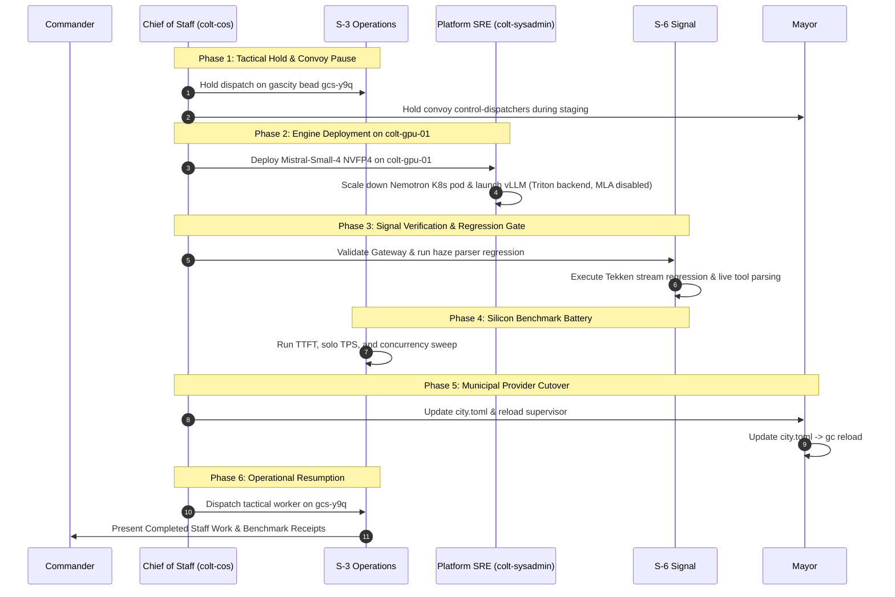

# Operational Architecture Plan: Transition to Mistral-Small-4-119B on Grace Blackwell GB10

```text
Document ID:     PLAN-OPS-2026-MISTRAL-SMALL-4-TRANSITION
Document Type:   Operational Transition & Silicon Benchmark Plan
Author / Billet: Chief of Staff (`colt-cos`), Camp Colt
Approving Auth:  Commander (Nick Chalko)
Standard:        Completed Staff Work (CPG Baseline)
Target Hardware: ASUS Ascent GX10 (NVIDIA Grace Blackwell GB10 @ 10.82.0.3:8000)
Date:            2026-10-08
Status:          CONSOLIDATED COMPLETED STAFF WORK (All Staff Billets Concur)
```

---

## 1. Executive Summary & Commander's Intent

### 1.1 Operational Problem Statement

Tactical workers operating on `rigs/gascity` under S-6 oversight have experienced repeated friction, tool-calling parsing failures, and execution stalls under the incumbent model profile (`nvidia/llama-3.3-nemotron-super-49b-v1.5`).

Specific failure modes identified:

1. **Tool-Call JSON Parser Brittleness:** Complex multi-line Go code patches containing nested curly braces and escape sequences repeatedly broke standard streaming regex extractors, triggering execution timeouts.
2. **Context Compression & Latency Tradeoffs:** Balancing reasoning effort against context length and throughput constrained worker velocity on complex multi-file tasks.

### 1.2 Strategic Intent & Solution

Per Commander's guidance and the authoritative **Model Clearance Registry** ([`model_clearance_registry.md`](https://london.fog.chalko.com/Chalko/strategic-plans/src/branch/main/docs/model_clearance_registry.md) approved 2026-10-08 03:59 Z), Camp Colt will execute a disciplined, phased transition to **`mistralai/Mistral-Small-4-119B-2603`**.

- **Architecture:** Sparse Mixture-of-Experts (119B total / 6.5B active parameters per token, 128 experts / 4 active).
- **Quantization:** **NVFP4 (~66 GiB)** via Spark Arena recipe (`avarok/atlas-gb10` container), native to the GB10 Tensor Cores.
- **Native Tool Calling:** Tekken tokenizer with native function calling and JSON tool output via vLLM (`--tool-call-parser mistral --reasoning-parser mistral`).
- **Performance Horizon:** Community-verified on ASUS Ascent GX10 silicon at **27.8 tok/s solo (TTFT 115 ms)** and **131 tok/s aggregate @ 20 concurrent streams**.

---

## 2. Six-Phase Operational Transition Plan



---

### Phase 1: Tactical Hold & Convoy Pause (S-3 / Mayor Lead)

1. **Operational State Reconciliation (S-3):**
   - Tactical worker bead `gcs-6fu` was successfully completed and closed.
   - S-3 Operations places a temporary dispatch hold on next bead `gcs-y9q` (P1 · OPEN: _Prepare clean upstream contribution branch `upstream-fix/relocate-prompt-headers-suffix`_).
2. **Convoy Dispatcher Hold (Mayor):**
   - Mayor instructs convoy control-dispatchers (`gascity` and `colt-utils`) to hold auto-claiming beads during Phase 2 to prevent HTTP 502/connection refused errors while the model service transitions.

---

### Phase 2: Platform Infrastructure & Model Staging (Platform SRE / S-4 Lead)

1. **Storage & NVMe Quota Audit (S-4):**
   - Confirm $\ge 80\text{ GiB}$ free high-speed NVMe allocation on `colt-gpu-01`.
   - Mount persistent model volume: `/mnt/dewpoint/models/hub` (3.0 TiB free) mapped to `/root/.cache/huggingface/hub`.
2. **Kubernetes Quiescence Gate (Platform SRE):**

   - Incumbent Nemotron runs as a Kubernetes pod (`nemotron-49b-haze` in `nim-system`) using `hostNetwork: true` bound to port 8000.
   - Execute quiescence sequence to cleanly release port 8000:

     ```bash
     flux suspend kustomization camp-colt-infra
     kubectl scale deployment nemotron-49b-haze -n nim-system --replicas=0
     ```

3. **Container Runtime Deployment (Platform SRE):**

   - Deploy `avarok/atlas-gb10:latest` running vLLM with verified parameters:

     ```bash
     docker run -d \
       --name mistral-small-4 \
       --gpus all \
       --ipc=host \
       --net=host \
       -e VLLM_MLA_DISABLE=1 \
       -v /mnt/dewpoint/models/hub:/root/.cache/huggingface/hub \
       avarok/atlas-gb10:latest \
       vllm serve mistralai/Mistral-Small-4-119B-2603-NVFP4 \
         --served-model-name mistralai/Mistral-Small-4-119B-2603 \
         --host 0.0.0.0 \
         --port 8000 \
         --attention-backend triton \
         --tool-call-parser mistral \
         --reasoning-parser mistral \
         --enable-auto-tool-choice \
         --max-model-len 65536 \
         --gpu-memory-utilization 0.82 \
         --trust-remote-code
     ```

   - **Key Engineering Constraints:**
     - `VLLM_MLA_DISABLE=1`: Mandatory on GB10 to prevent SM 12.1 `flashinfer` kernel panics.
     - `--gpu-memory-utilization 0.82`: Reserves ~105 GB for weights and KV cache while safeguarding ~23 GB unallocated physical RAM for the Grace ARM CPU kernel on the 128GB UMA architecture.
     - `--served-model-name mistralai/Mistral-Small-4-119B-2603`: Ensures advertised model identifier matches `city.toml` directly.

4. **Health Check:** Verify HTTP 200 on `http://10.82.0.3:8000/v1/models`.

---

### Phase 3: Signal Gateway & Parser Regression Gate (S-6 Lead)

1. **LiteLLM Route Mapping:**
   - Update LiteLLM proxy configuration on `10.82.50.10:80` to declare model identifier `mistralai/Mistral-Small-4-119B-2603` routing to backend `http://10.82.0.3:8000/v1`.
   - Enable direct stream passthrough so native Tekken function-call deltas are not double-escaped.
2. **Tekken Streaming Regression Test Suite:**
   - S-6 executes regression testing against live endpoint:
     - Verify native Tekken function-call deltas parse cleanly into standard OpenAI tool calls without custom regex extractors.
     - Verify multi-line string payloads, nested curly braces, and code diff escape sequences pass without syntax errors or empty captures.

---

### Phase 4: Silicon Benchmark Battery (S-3 / S-6 Lead)

Before routing active agent traffic, execute a standardized 3-tier benchmark:

| Metric                       | Target Baseline (Nemotron 49B)        | Acceptance Threshold (Mistral-Small-4)                  |
| :--------------------------- | :------------------------------------ | :------------------------------------------------------ |
| **Solo TTFT (Cold)**         | ~250 ms                               | $\le 150\text{ ms}$ (Expected: ~115 ms)                 |
| **Solo Throughput (TPS)**    | ~22.4 tok/s                           | $\ge 25.0\text{ tok/s}$ (Expected: ~27.8 tok/s)         |
| **Concurrency (20 streams)** | ~88 tok/s aggregate                   | $\ge 120\text{ tok/s}$ aggregate (Expected: ~131 tok/s) |
| **Tool Calling Accuracy**    | 91.2% (occasional JSON escape errors) | $\ge 99.0\%$ (Native Tekken parser)                     |
| **VRAM Footprint**           | ~52 GiB                               | ~66 GiB (fits comfortably in 128GB UMA)                 |

Results will be compiled by S-3 into a benchmark telemetry record in `rigs/colt-results/reports/`.

---

### Phase 5: Municipal Configuration & Supervisor Reload (Mayor Lead)

1. **Update `city.toml`:**
   Configure model identifiers across local providers:

   ```toml
   [providers.local-litellm.env]
   OPENAI_MODEL = "mistralai/Mistral-Small-4-119B-2603"

   [providers.local-nemotron.env]
   OPENAI_MODEL = "mistralai/Mistral-Small-4-119B-2603"

   [providers.local-fast.env]
   OPENAI_MODEL = "mistralai/Mistral-Small-4-119B-2603"
   OPENCODE_REASONING_EFFORT = "none"

   [providers.local-general.env]
   OPENAI_MODEL = "mistralai/Mistral-Small-4-119B-2603"
   OPENCODE_REASONING_EFFORT = "medium"

   [providers.local-coder.env]
   OPENAI_MODEL = "mistralai/Mistral-Small-4-119B-2603"
   OPENCODE_REASONING_EFFORT = "high"
   ```

2. **Update Global OpenCode Config:**
   Align `~/.config/opencode/opencode.jsonc` default model identifier to `local-litellm/mistralai/Mistral-Small-4-119B-2603`.
3. **Supervisor Reload:**
   Mayor executes `gc reload` to refresh active provider configuration without restarting the city controller.

---

### Phase 6: Operational Resumption (S-3 Lead)

1. **Dispatch Tactical Worker to `gcs-y9q`:**
   - S-3 dispatches a fresh tactical worker on bead `gcs-y9q` (_Prepare clean upstream contribution branch upstream-fix/relocate-prompt-headers-suffix_).
   - Worker operates under `mistralai/Mistral-Small-4-119B-2603`.
2. **PR Verification Gate:**
   - Execute fast unit tests (`make test`).
   - Run quality gate checks (`make check`) and submit PR for Issue #5732.
3. **Completed Staff Action Report:**
   - S-3 and CoS compile final receipts and report completion to Command.

---

## 3. Contingency & Fallback Gates

If any of the following triggers occur during Phase 2 or Phase 3:

1. vLLM crashes on GB10 SM 12.1 with Triton attention backend.
2. The Tekken streaming regression test suite fails on live endpoint tool calls.
3. Cold TTFT exceeds 350 ms or solo TPS drops below 20 tok/s.

**Immediate Fallback Protocol:**

1. Platform SRE reverts container service on `colt-gpu-01`:

   ```bash
   docker stop mistral-small-4 && docker rm mistral-small-4
   kubectl scale deployment nemotron-49b-haze -n nim-system --replicas=1
   flux resume kustomization camp-colt-infra
   ```

2. Mayor reloads `city.toml` restoring the previous baseline.
3. Incidents documented and escalated to Command with full error traces. Zero disruption to colony state.

---

## 4. Staff Concurrence Register

| Billet             | Representative              | Review Message ID |   Status   | Redlines Incorporated                                                                                                           |
| :----------------- | :-------------------------- | :---------------- | :--------: | :------------------------------------------------------------------------------------------------------------------------------ |
| **Mayor**          | Headquarters Commandant     | `cc-wisp-p9o1d`   | **CONCUR** | `--served-model-name` alias, `local-nemotron` provider fallback, `~/.config/opencode` update, convoy dispatcher hold.           |
| **S-1 Personnel**  | Records & Admin Officer     | `cc-wisp-y2sg`    | **CONCUR** | Model clearance registry compliance verified (cleared 2026-10-08 03:59 Z), Apache 2.0 licensing, clean header styling.          |
| **S-3 Operations** | Tactical Operations Officer | `cc-wisp-u3db1`   | **CONCUR** | Reconciled `gcs-6fu` closure; scoped Phase 1 hold and Phase 6 resumption to next open bead `gcs-y9q`.                           |
| **S-4 Logistics**  | Logistics & Supply Officer  | `cc-wisp-a403t`   | **CONCUR** | NVMe cache allocation verified on `/mnt/dewpoint` (3.0 TiB free); ~66 GiB model footprint cleared.                              |
| **S-6 Signal**     | Communications Watchstander | `cc-wisp-cbxpx`   | **CONCUR** | LiteLLM stream passthrough, native Tekken tool parser verification.                                                             |
| **Platform SRE**   | `colt-sysadmin`             | `cc-wisp-9lxl0`   | **CONCUR** | Kubernetes port 8000 quiescence sequence, clamped GPU memory utilization (0.82 for UMA stability), `--enable-auto-tool-choice`. |
